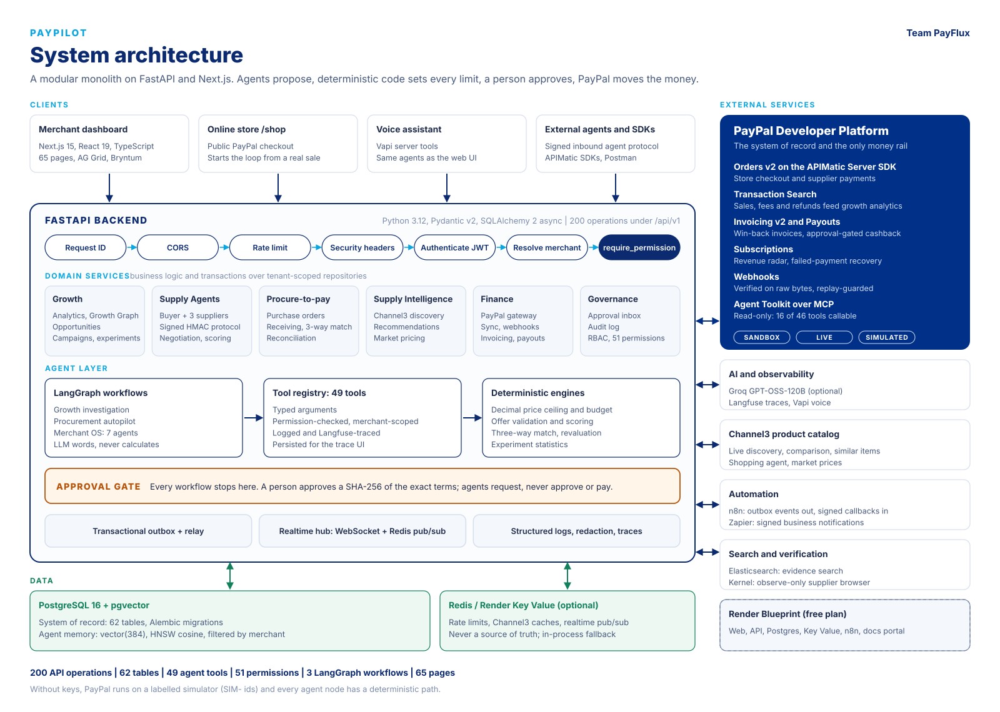
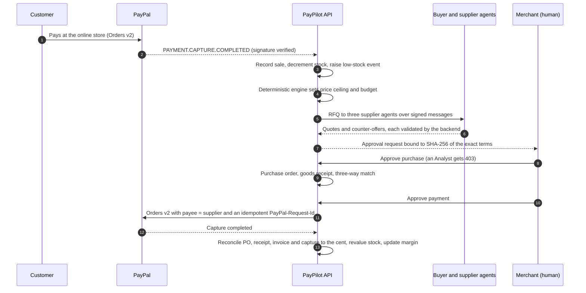

<div align="center">

# PayPilot

### The AI operating system for PayPal merchants

Growth intelligence, an agent-to-agent supply network and human-approved PayPal settlement in one product.
AI agents find the opportunity and negotiate the purchase. Deterministic code sets every limit.
A person approves every dollar. PayPal moves the money.

[](#team-name)
[](docs/PAYPAL.md)
[](docs/TESTING.md)
[](LICENSE)

[](https://www.python.org)
[](https://fastapi.tiangolo.com)
[](https://langchain-ai.github.io/langgraph/)
[](https://github.com/pgvector/pgvector)
[](docs/CONFIGURATION.md#redis)
[](https://nextjs.org)
[](https://react.dev)
[](https://www.typescriptlang.org)
[](docker-compose.yml)
[](render.yaml)

**[Quick start](docs/QUICKSTART.md)** |
**[Architecture](docs/ARCHITECTURE.md)** |
**[Deployment](docs/DEPLOYMENT.md)** |
**[PayPal integration](docs/PAYPAL.md)** |
**[API reference](docs/API.md)** |
**[All documentation](docs/README.md)**

</div>

---

## Team Name

**PayFlux**

## Project Name

**PayPilot**

## Team Members

- **Member 1**: [Madhur Prakash](https://github.com/Madhur-Prakash)
- **Member 2**: [Bhanvi Nayer](https://github.com/bhanvinayer)

---

## Demo Video Link

<!-- Replace # with the demo video URL -->
[YouTube Video Link](https://youtu.be/yCqvBDw_EzY)

---

## Live Demo

- **App**: <https://paypilot-web-0lqv.onrender.com> (sign in as `owner@juniperoak.com` / `Autopilot@2024`)
- **API (Swagger)**: <https://paypilot-api-bjn2.onrender.com/docs>
- **Developer portal (APIMatic)**: <https://paypilot-docs.onrender.com>

The hosted services run on Render's free plan, so the first request after an idle period takes about a minute.

---

## Architecture



PayPilot is a **modular monolith**: one FastAPI backend and one Next.js frontend, sharing a single
PostgreSQL database. Each layer has one job, and the layer boundaries are where the safety rules live.

| Layer | What lives there | Key files |
| --- | --- | --- |
| **Clients** | Merchant dashboard (65 pages), public PayPal store (`/shop`), Vapi voice, external agents and SDKs | [`frontend/src/app`](frontend/src/app) |
| **Request pipeline** | Request ID, CORS allow-list, rate limit, security headers, JWT authentication, membership-verified merchant scope, `require_permission` | [`core/middleware.py`](backend/app/core/middleware.py), [`api/deps.py`](backend/app/api/deps.py) |
| **API** | 200 operations under `/api/v1` in 18 tag groups; thin handlers that validate and delegate | [`backend/app/api/v1`](backend/app/api/v1) |
| **Domain services** | Growth, Supply Agents, procure-to-pay, Supply Intelligence, Finance (PayPal), Governance | [`backend/app/services`](backend/app/services) |
| **Agent layer** | Three LangGraph workflows calling a registry of 49 typed, permission-checked tools; deterministic `Decimal` engines for every number | [`backend/app/agents`](backend/app/agents), [`backend/app/tools`](backend/app/tools) |
| **Approval gate** | Every workflow ends here. Approvals bind to a SHA-256 of the exact terms and are re-verified at execution | [`services/supply/approvals.py`](backend/app/services/supply/approvals.py) |
| **Platform** | Transactional outbox and relay, realtime WebSocket hub, structured logging with redaction, Langfuse traces | [`services/inventory/relay.py`](backend/app/services/inventory/relay.py), [`api/realtime.py`](backend/app/api/realtime.py) |
| **Data** | PostgreSQL 16 + pgvector (62 tables, agent memory), optional Redis for shared rate limits, caches and pub/sub | [`backend/app/db/models`](backend/app/db/models), [`core/redis.py`](backend/app/core/redis.py) |
| **External** | PayPal (8 capabilities), Channel3, Groq, Langfuse, Vapi, n8n, Zapier, Elasticsearch, Kernel | [`backend/app/integrations`](backend/app/integrations) |

### How money moves

The full loop, from a customer's PayPal payment to a reconciled supplier payment. Every step marked
"human" is an authenticated, permission-checked endpoint; no agent and no graph edge can reach it.



### Rules enforced in code

1. **No AI arithmetic.** Every amount, limit, score and match comes from a `Decimal` engine or SQL
   ([`services/supply/policy.py`](backend/app/services/supply/policy.py)). An LLM may propose a counter-offer;
   an out-of-bounds proposal is refused, not clamped.
2. **Humans approve money movement.** Agents can request, never approve. The agent tools named
   `approve_purchase` and `pay_supplier_invoice` exist only to refuse. Owners are not exempt.
3. **Approvals bind to exact terms.** A SHA-256 of the canonical terms and the policy version is stored and
   re-checked at execution; any change invalidates the approval.
4. **Idempotent payments.** `PayPal-Request-Id` is derived from the business action, so a retry cannot pay twice.
5. **Verified webhooks only.** PayPal's `verify-webhook-signature` runs on the raw body first; the event id is a
   replay guard; unverified events are stored as `REJECTED` and never acted on.
6. **Signed agent messages.** Per-agent HMAC, strict schemas, sender roles, freshness and replay protection at
   one verification boundary.
7. **Tenant isolation is structural.** The merchant comes from the caller's membership; repositories filter
   every query by it.
8. **Nothing simulated is presented as real.** `SANDBOX`, `LIVE` or `SIMULATED` is stored on every PayPal row
   and shown in the UI.

Full design notes, request lifecycle, data model and more diagrams: **[docs/ARCHITECTURE.md](docs/ARCHITECTURE.md)**.

---

## What PayPilot does

Small merchants see last week's sales but not why they moved. They discover a stockout after it happens,
source more by emailing suppliers, and pay quotes they never negotiated. Automating any of this is risky,
because the steps that matter move money. PayPilot connects four loops on one dataset:

| Loop | Flow |
| --- | --- |
| **Growth Intelligence** | Observe -> diagnose -> recommend -> **approve** -> act -> measure with a controlled experiment -> learn |
| **Supply Agents** | Detect demand -> compute limits -> RFQ -> agent-to-agent negotiation -> evaluate -> **approve** -> PO -> receive -> three-way match -> **approve payment** -> PayPal -> reconcile |
| **Supply Intelligence** | Sales and inventory -> expansion opportunity -> live Channel3 products -> compare -> recommendation -> **approve** -> catalog or PayPal test-stock order -> measure |
| **Unified intelligence** | Shared business events and memory: demand drives procurement, procurement cost drives margin, stock levels shape campaigns |

On the seeded demo merchant (Juniper & Oak Coffee, Portland), the procurement loop computes these figures
deterministically: demand **+71%** (7 -> 12 bags a day), **3.5 days** of cover, a ceiling of
`$18.00 x (1 - 40%) = $10.80` per bag, a negotiated order of **$1,455.00** that is **$248.77** below the best
opening quote, and a product margin that moves from **35.6% to 43.8%** after reconciliation.

---

## PayPal integration

PayPal is the merchant's system of record and the only rail money moves on.

| PayPal capability | Used for | Code |
| --- | --- | --- |
| OAuth 2.0 client credentials | Cached, lock-guarded token refresh, server side only | [`integrations/paypal/client.py`](backend/app/integrations/paypal/client.py) |
| Orders v2 (customer checkout) | The online store: server-priced cart, idempotent capture, webhook and return both record the sale once | [`services/shop.py`](backend/app/services/shop.py) |
| Orders v2 (supplier payment) | Payee = supplier, on PayPal's APIMatic-generated Server SDK, only after approval and a three-way match | [`integrations/paypal/server_sdk.py`](backend/app/integrations/paypal/server_sdk.py) |
| Transaction Search | Incremental sync in 31-day windows feeding growth analytics | [`services/paypal/sync.py`](backend/app/services/paypal/sync.py) |
| Invoicing v2 | Merchant-to-customer invoices with reminders and cancellation | [`services/paypal/finance.py`](backend/app/services/paypal/finance.py) |
| Payouts | Approval-gated cashback; never used for suppliers | [`services/paypal/finance.py`](backend/app/services/paypal/finance.py) |
| Catalog, Plans, Subscriptions | Plans, lifecycle actions, subscription revenue radar with one-click recovery | [`services/paypal/radar.py`](backend/app/services/paypal/radar.py) |
| Webhooks | Signature-verified on raw bytes, replay-guarded, idempotent handlers | [`services/paypal/webhooks.py`](backend/app/services/paypal/webhooks.py) |
| Agent Toolkit over MCP | Read-only bridge: 16 of PayPal's 46 tools callable, the 30 that create, pay or send are blocked in code | [`integrations/paypal/mcp.py`](backend/app/integrations/paypal/mcp.py) |

Without credentials everything runs on a deterministic simulator with `SIM-` identifiers.
Details, modes and sandbox setup: **[docs/PAYPAL.md](docs/PAYPAL.md)**.

---

## Tech stack

| Area | Technology |
| --- | --- |
| Backend | Python 3.12, FastAPI 0.141, Pydantic v2, SQLAlchemy 2 (async), Alembic, asyncpg |
| Agents | LangGraph 1.2, Groq GPT-OSS-120B (optional), deterministic fallback for every node |
| Data | PostgreSQL 16, pgvector (HNSW cosine), Redis 7 or Render Key Value (optional) |
| Frontend | Next.js 15 (App Router), React 19, TypeScript 5.7, Tailwind CSS, shadcn/ui, TanStack Query, Zustand |
| Data grids and charts | AG Grid Community 36.3, AG Studio, Bryntum Gantt and Scheduler 8.0, Recharts |
| Payments | PayPal REST APIs, `paypal-server-sdk` 2.4.0 (APIMatic-generated), PayPal MCP server |
| Product data | Channel3 catalog API |
| Automation | n8n 2.46 (HMAC-signed both ways), Zapier Catch Hook |
| Observability | Structured JSON logs with redaction, Langfuse traces |
| Delivery | Docker Compose, Render Blueprint, APIMatic portal and SDKs, Postman collection |

---

## Quick start

No API keys are needed. Without them PayPal runs on a labelled simulator and every agent runs in
deterministic mode.

**Everything in Docker** (only Docker required):

```bash
git clone https://github.com/Madhur-Prakash/PayPilot.git
cd PayPilot
docker compose up -d --build
```

Open <http://localhost:3000>. The API is at <http://localhost:8000/docs> and n8n at <http://localhost:5678>.
The first start migrates and seeds the demo merchant, which takes about two minutes.

**Local development** (Python 3.11-3.14, Node 20+, Docker for Postgres):

```bash
make init     # tools check, .env, dependencies, Postgres, migrations, demo seed
make dev      # backend on :8000, frontend on :3000
```

On Windows PowerShell without Make:

```powershell
powershell -ExecutionPolicy Bypass -File scripts\setup.ps1
powershell -ExecutionPolicy Bypass -File scripts\dev.ps1
```

**Demo accounts** (password `Autopilot@2024` for all):

| Role | Email | Can |
| --- | --- | --- |
| Owner | `owner@juniperoak.com` | Everything, including users |
| Admin | `admin@juniperoak.com` | Approve and execute purchases and payments |
| Analyst | `analyst@juniperoak.com` | Source and negotiate; cannot approve or pay |
| Staff | `staff@juniperoak.com` | Receive goods, inventory actions |
| Viewer | `viewer@juniperoak.com` | Read only |

Step-by-step guides: **[Quick start](docs/QUICKSTART.md)** and **[Installation](docs/INSTALLATION.md)**.

---

## Deployment

| Target | Command or file | Guide |
| --- | --- | --- |
| Docker Compose | `docker compose up -d --build` (Postgres, Redis, API, worker, web, n8n) | [Deployment: Docker Compose](docs/DEPLOYMENT.md#docker-compose) |
| Render | [`render.yaml`](render.yaml): API, web, Postgres, Key Value, n8n and the docs portal, all on the free plan | [Deployment: Render](docs/DEPLOYMENT.md#render-blueprint) |
| Any container host | [`backend/Dockerfile`](backend/Dockerfile), [`frontend/Dockerfile`](frontend/Dockerfile) | [Deployment: other platforms](docs/DEPLOYMENT.md#other-platforms) |

Before real traffic, work through the [production checklist](docs/DEPLOYMENT.md#production-checklist).

---

## Documentation

| Document | Contents |
| --- | --- |
| [Quick start](docs/QUICKSTART.md) | Running in five minutes, three ways |
| [Installation](docs/INSTALLATION.md) | Prerequisites, platform notes, manual setup, verification |
| [Configuration](docs/CONFIGURATION.md) | Every environment variable and how each integration is enabled |
| [Deployment](docs/DEPLOYMENT.md) | Docker Compose, Render Blueprint, other hosts, production checklist |
| [Architecture](docs/ARCHITECTURE.md) | System design, request lifecycle, data model, events, diagrams |
| [Agents](docs/AGENTS.md) | LangGraph workflows, the 49-tool registry, LLM handling |
| [Agent memory](docs/MEMORY.md) | Long-term memory on pgvector with tenant isolation |
| [Supply Agents](docs/SUPPLY_AGENTS.md) | Agent-to-agent procurement, signed protocol, negotiation, three-way match |
| [Supply Intelligence](docs/SUPPLY_INTELLIGENCE.md) | Channel3 product discovery, recommendations, approved purchases |
| [PayPal integration](docs/PAYPAL.md) | Every PayPal API used, modes, webhooks, sandbox setup |
| [Integrations](docs/INTEGRATIONS.md) | Channel3, AG Grid, AG Studio, Bryntum, APIMatic, Render, Elasticsearch, Kernel, Zapier, Postman |
| [Automation](docs/AUTOMATION.md) | Transactional outbox, n8n workflows, signed callbacks |
| [API portal and SDKs](docs/APIMATIC.md) | Building the APIMatic portal, Python and TypeScript SDKs |
| [API reference](docs/API.md) | Every endpoint with its permission, envelopes and error codes |
| [Security](docs/SECURITY.md) | Authentication, RBAC, tenant isolation, approval gates, auditing |
| [Data](docs/DATA.md) | Data model and the deterministic demo dataset |
| [Testing](docs/TESTING.md) | Test suites, how to run them, how to add to them |
| [Contributing](docs/CONTRIBUTING.md) | Conventions and adding a feature end to end |
| [Troubleshooting](docs/TROUBLESHOOTING.md) | Symptom, cause, fix |

---

## Repository layout

```
backend/                 FastAPI application
  app/
    api/v1/              18 routers: auth, dashboard, growth, campaigns, agents, inventory, supply,
                         supply_intel, approvals, paypal, payments, shop, intelligence, memory,
                         integrations, voice, admin (+ health)
    agents/              LangGraph workflows: growth graph, procurement graph, Merchant OS
    tools/               49-tool agent registry
    services/            business logic: analytics, growth, campaigns, experiments, inventory,
                         supply, supply_intel, discovery, paypal, intelligence, integrations, auth
    integrations/        PayPal (client, Server SDK, simulator, MCP), Channel3, Groq, Langfuse,
                         Vapi, Elasticsearch, Kernel, Zapier, vector memory
    db/models/           SQLAlchemy models (62 tables)
    core/                config, security, permissions, middleware, rate limiting, Redis, logging
    seed/                deterministic demo dataset and supply network
  alembic/versions/      database migrations
  tests/                 unit, api and integration suites (SQLite, no Docker needed)
frontend/                Next.js 15 application
  src/app/               65 pages: (auth), (dashboard), shop
  src/components/        feature components, shadcn/ui primitives
  src/lib/               API client, Studio adapter, utilities
n8n/                     workflow builder, Docker image and Render start script
apimatic/                APIMatic project for PayPilot's own API (portal, SDKs, Context Plugin)
postman/                 Postman collection (59 requests) and local environment
scripts/                 cross-platform task runner, setup and dev scripts, diagram and OpenAPI export
docker/                  Postgres init (pgvector, pgcrypto)
docs/                    technical documentation and diagrams
docker-compose.yml       full local stack
render.yaml              Render Blueprint
Makefile                 every developer command (delegates to scripts/tasks.py)
```

---

## Testing and quality

```bash
make test            # backend pytest (SQLite, no Docker, no keys) + frontend vitest
make lint            # ruff + next lint
make typecheck       # tsc --noEmit (+ advisory mypy)
make build           # backend import check + next build
make verify          # lint + typecheck + test
```

The backend suite covers the financial engine (Decimal limits, tampered totals), the agent protocol (bad
signatures, cross-tenant, stale and replayed messages), the PayPal client against mocked PayPal responses
(token refresh, retries, idempotency, 31-day windows, webhook verification), approval invalidation, RBAC
denials, tenant isolation, pgvector memory isolation and the end-to-end procurement lifecycle through the
real API. Details: **[docs/TESTING.md](docs/TESTING.md)**.

---

## Known limitations

* **Verified live against the PayPal sandbox:** OAuth, and the Orders v2 supplier payment (create, buyer
  approval, capture) on the official Server SDK. Transaction Search, Invoicing, Payouts, Subscriptions and
  webhook verification are verified against the simulator and mocked PayPal responses.
* PayPal's sandbox MCP runtime currently returns `Unsupported cache mode: default` for every tool call; the
  bridge reports it as an error rather than as data.
* Supplier agents in the demo are simulated policy engines and are labelled as such; external agents can
  connect through the signed inbound endpoint.
* Analytics run on a seeded demo dataset; synced PayPal transactions are stored and shown with their mode.
* AG Studio runs in evaluation mode without a licence key, and Bryntum on a trial key; both show a watermark.
* Render's free plan sleeps idle services and expires the free database after 30 days.

---

## License

MIT. See [LICENSE](LICENSE).

---

<div align="center">

Made with ❤️ for PayPal Hackathon

</div>
