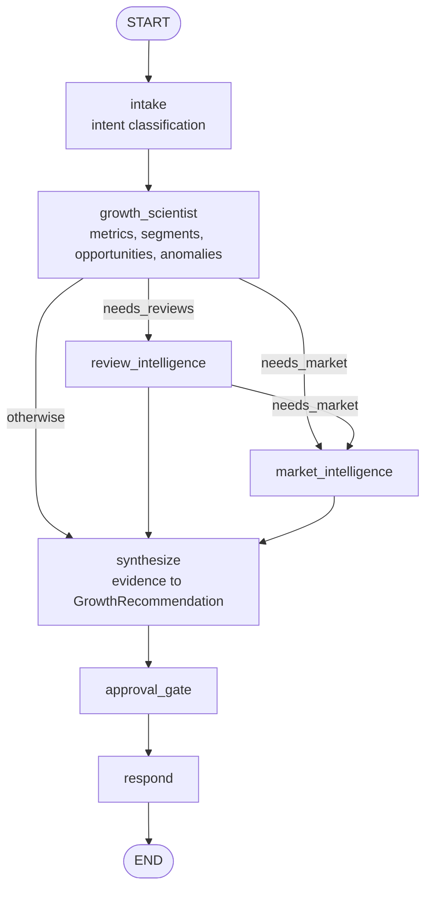
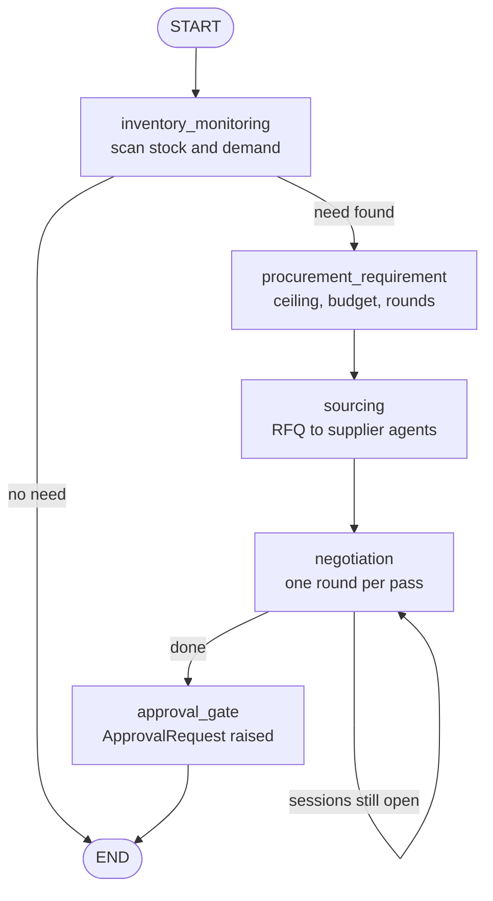
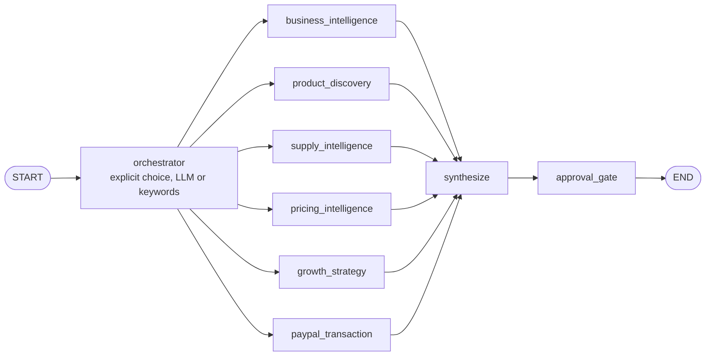

<div align="center">

# Agents

Three LangGraph workflows, one registry of 49 tools, and one rule: the model interprets, it never calculates.

[](README.md)
[](ARCHITECTURE.md)
[](MEMORY.md)
[](SUPPLY_AGENTS.md)
[](https://langchain-ai.github.io/langgraph/)

</div>

---

## Contents

- [The rule that shapes the design](#the-rule-that-shapes-the-design)
- [Workflows](#workflows)
- [Growth investigation](#growth-investigation)
- [Procurement autopilot](#procurement-autopilot)
- [Merchant OS](#merchant-os)
- [Graph state](#graph-state)
- [The tool registry](#the-tool-registry)
- [Tool catalogue](#tool-catalogue)
- [Per-agent allow-lists](#per-agent-allow-lists)
- [Prompts and structured output](#prompts-and-structured-output)
- [LLM failure handling](#llm-failure-handling)
- [The deterministic path](#the-deterministic-path)
- [Traces](#traces)
- [Voice](#voice)
- [Agent API](#agent-api)
- [Extending the agent layer](#extending-the-agent-layer)

---

## The rule that shapes the design

> The LLM never calculates a business number.

```
PostgreSQL and Python                      LLM
---------------------                      ---
revenue          = $24,693       ---->     reads structured, computed facts
evening revenue  = -31.9%                  chooses which read tool to call next
opportunity      = $724 / month            writes the hypothesis and explanation
price ceiling    = $10.80 / bag            proposes a counter-offer (bounds-checked)
confidence       = 0.92                    phrases the recommendation
```

It is enforced in four places:

1. **Tools return computed results.** No tool hands raw rows to a model; the largest payload is an aggregated
   fact sheet.
2. **Detectors size opportunities.** [`OpportunityDetector`](../backend/app/services/growth/detector.py)
   computes `estimated_value_monthly` and `confidence` from explicit formulas with named assumptions.
3. **The orchestrator overwrites the model.** After the LLM returns a `GrowthRecommendation`, `synthesize`
   resets `estimated_impact`, `confidence` and `requires_approval` to the detector's values. The model may
   phrase; it may not price.
4. **Negotiation proposals are validated.** The buyer agent's LLM strategist may propose a counter-offer; the
   [financial engine](SUPPLY_AGENTS.md#the-financial-engine) refuses any proposal outside the computed bounds
   rather than clamping it.

A corollary: the product works with no LLM at all. Every node has a deterministic path, and runs that take it
are flagged `used_fallback: true` and labelled "Deterministic mode".

---

## Workflows

| Workflow | File | Entry points | Ends at |
| --- | --- | --- | --- |
| Growth investigation | [`agents/graph.py`](../backend/app/agents/graph.py), [`agents/orchestrator.py`](../backend/app/agents/orchestrator.py) | `POST /agents/ask`, `POST /agents/investigate`, voice | Approval gate, then a reply |
| Procurement autopilot | [`agents/procurement_graph.py`](../backend/app/agents/procurement_graph.py) | `POST /procurement/autopilot` | A `PROCUREMENT_PURCHASE` approval request |
| Merchant OS | [`agents/merchant_os.py`](../backend/app/agents/merchant_os.py) | `POST /agents/execute`, `POST /growth/autopilot/run` | Approval gate (purchases become `MERCHANT_PURCHASE` requests) |

---

## Growth investigation



Routing is conditional, not parallel. `workflow="investigate"` forces the full fan-out; a conversational `ask`
engages only the specialists the intent classifier selected.

| Node | Role | Tools |
| --- | --- | --- |
| `intake` | Classify the question; LLM when configured, keyword table otherwise | none |
| `growth_scientist` | Compute the fact sheet, segment it, run detection | `GROWTH_SCIENTIST_TOOLS` |
| `review_intelligence` | Topics, sentiment, emerging complaints per 100 orders | `get_review_summary`, `search_reviews` |
| `market_intelligence` | Competitor perception, external signals scored against revenue exposure | `get_competitor_summary`, `get_external_signals` |
| `synthesize` | Evidence to a schema-validated `GrowthRecommendation`; numbers reset to the detector's | none |
| `approval_gate` | Marks anything money-moving as requiring approval. **The graph ends here for execution** | none |
| `respond` | Compose the reply and follow-ups | none |

After the gate, only an authenticated person can continue: `POST /agents/opportunities/{id}/approve` requires
**both** `campaign:execute` and `experiment:approve`, then runs the action (segment, campaign) and the controlled
experiment. `POST /agents/experiments/{id}/measure` recomputes the result from the transaction ledger; the
decision (scale, continue, stop) is computed, and the model only explains it.

---

## Procurement autopilot



Each node delegates to `NegotiationService`, which records an agent step for every stage, so the graph and the
step-by-step Negotiation Workspace produce the same trace. Message idempotency keys are derived from the stage,
so a re-run reuses what exists. Purchase order, invoice, receiving, matching, payment and reconciliation happen
after a person approves, through permission-checked endpoints. Details: [Supply Agents](SUPPLY_AGENTS.md).

---

## Merchant OS



| Agent | Tools |
| --- | --- |
| Orchestrator | Routes by explicit choice, LLM classification, or keywords (deterministic fallback) |
| Business Intelligence | `get_sales_summary`, `get_product_performance`, `analyze_assortment`, `get_inventory_status` |
| Product Discovery | `discover_products`, `get_product_details`, `find_similar_products`, `compare_products` |
| Supply Intelligence | `analyze_assortment`, `discover_products`, `find_similar_products`, `list_supply_recommendations` |
| Pricing Intelligence | `get_market_price_intelligence`, `get_market_benchmark` |
| Growth Strategy (Growth Autopilot) | `analyze_assortment`, `generate_supply_recommendations`, `list_supply_recommendations`, `get_top_opportunity` |
| PayPal Transaction | `get_payment_history`, `get_paypal_transaction_insights`, `request_purchase_payment` (raises an approval request only) |

Transient tool failures are retried up to twice with backoff. The LLM may route and word the answer; it is
instructed to keep every number and verdict exactly as the tools stated them. No agent can approve, create an
order, capture or pay. Details: [Supply Intelligence](SUPPLY_INTELLIGENCE.md#the-merchant-os-agents).

---

## Graph state

[`agents/state.py`](../backend/app/agents/state.py) defines the growth graph's `TypedDict` state. `ctx` carries a
`ToolContext` with the merchant scope, the caller's permission set and the trace, so a node can never act outside
what the request was authorised to do.

**Channel semantics, and a trap.** Every key is last-value-wins and nodes return the whole state. That is correct
because the graph is sequential: each node routes to exactly one successor. An earlier version used
`Annotated[list, operator.add]` reducers *and* had nodes return the full accumulated state, so LangGraph
appended the list to itself at every node: 7 steps became 70+, 8 tool calls became 352. If a concurrent fan-out
is ever added, the reducers must come back **and** nodes must return only their own delta; doing one without the
other silently duplicates everything.

---

## The tool registry

[`tools/base.py`](../backend/app/tools/base.py). A tool is the only way an agent touches the business.

| Guarantee | How |
| --- | --- |
| Typed | Arguments validated against a Pydantic model before dispatch |
| Authorised | The tool's permission is checked against the caller's permission set |
| Scoped | Bound to one merchant through `ToolContext`; no argument can widen it |
| Logged | One structured line with duration and status |
| Traced | A Langfuse span with arguments and result |
| Recorded | Persisted to `agent_tool_calls` for the trace UI |
| Error-safe | `registry.execute()` never raises; failures return a `ToolResult` with `ok=False` |

```python
@registry.register(
    "detect_growth_opportunities",
    description="Run the deterministic opportunity detector...",
    args_model=WindowArgs,
    permission=Permission.GROWTH_READ,
)
async def detect_growth_opportunities(ctx: ToolContext, args: WindowArgs) -> tuple[dict, str]:
    ...
    return data, human_readable_summary
```

Each handler returns `(data, summary)`; the summary is what the trace UI shows and what the model reads first.
`GET /api/v1/agents/tools` lists the registry live.

---

## Tool catalogue

All 49 tools and the permission each requires.

### Analytics ([`tools/analytics.py`](../backend/app/tools/analytics.py))

| Tool | Permission | Returns |
| --- | --- | --- |
| `get_sales_summary` | `dashboard:read` | Revenue, orders, AOV, repeat rate, margin, with period deltas |
| `get_revenue_trend` | `growth:read` | Daily revenue and orders |
| `get_customer_segments` | `customers:read` | Per-slot revenue, repeat customers, service time |
| `get_customer_metrics` | `customers:read` | Base health, retention, churn risk, lifetime value estimate |
| `get_product_performance` | `products:read` | Per-product revenue, units, margin, attach rate |
| `analyze_product_mix` | `products:read` | Basket pairs with support, confidence and lift |
| `detect_anomalies` | `growth:read` | Metrics outside normal variation |
| `get_growth_metrics` | `growth:read` | The complete computed fact sheet |
| `detect_growth_opportunities` | `growth:read` | Quantified, evidence-backed opportunities |
| `get_growth_graph` | `growth:read` | The metric decomposition with typed edges |
| `calculate_opportunity_value` | `growth:read` | Explicit arithmetic, so the model never does it |

### Intelligence ([`tools/intelligence.py`](../backend/app/tools/intelligence.py))

| Tool | Permission | Returns |
| --- | --- | --- |
| `get_review_summary` | `reviews:read` | Sentiment, topics, complaints per 100 orders |
| `search_reviews` | `reviews:read` | Vector similarity over review embeddings |
| `get_competitor_summary` | `competitors:read` | Perception comparison across dimensions |
| `get_external_signals` | `signals:read` | Signals scored against the merchant's revenue exposure |
| `get_inventory_status` | `inventory:read` | Days of cover, stockout risk, revenue at risk |

### Actions ([`tools/actions.py`](../backend/app/tools/actions.py))

| Tool | Permission | Notes |
| --- | --- | --- |
| `create_customer_segment` | `customers:read` | Read-only preview of who would be targeted |
| `create_campaign` | `campaign:create` | Created `PENDING_APPROVAL`, never delivered |
| `create_experiment` | `experiment:create` | Control and test arms, pending approval |
| `get_experiment_results` | `experiment:read` | Recomputed from the ledger |
| `list_active_experiments` | `experiment:read` | Running experiments |
| `execute_campaign` | `campaign:execute` | **Always refuses** and points at the human endpoint |
| `get_top_opportunity` | `growth:read` | Highest-priority open opportunity |
| `get_growth_allocation` | `growth:read` | Dual-market budget allocation across store and online |

### Supply Agents ([`tools/supply.py`](../backend/app/tools/supply.py))

| Tool | Permission | Notes |
| --- | --- | --- |
| `get_stockout_risks` | `inventory:read` | Items at risk with velocity and cover |
| `list_supplier_agents` | `vendor:read` | Public supplier profiles only; private policy is never serialised |
| `start_procurement` | `procurement:create` | Raises a procurement request and RFQ |
| `run_negotiation` | `procurement:negotiate` | Runs rounds within the computed policy |
| `get_procurement_status` | `procurement:read` | One request: offers, verdicts, recommendation |
| `get_procurement_overview` | `procurement:read` | All open procurements |
| `get_pending_approvals` | `approval:read` | The approval inbox |
| `approve_purchase` | `procurement:read` | **Always refuses**: approval is a human action |
| `pay_supplier_invoice` | `supplier_invoice:read` | **Always refuses**: payment is a human action |
| `get_paypal_transaction_insights` | `paypal:read` | Gross, net, fees, refunds, repeat payers |
| `sync_paypal_transactions` | `paypal:sync` | Incremental Transaction Search sync |
| `search_memory` | `memory:read` | Recall from long-term agent memory |

### Discovery and Supply Intelligence ([`tools/discovery.py`](../backend/app/tools/discovery.py))

| Tool | Permission | Notes |
| --- | --- | --- |
| `discover_products` | `products:read` | Natural-language Channel3 search with ranking |
| `get_product_details` | `products:read` | Fresh product detail |
| `find_similar_products` | `products:read` | Channel3 similar items |
| `compare_products` | `products:read` | Evidence-backed comparison |
| `analyze_assortment` | `products:read` | Category performance, expansion candidates (SQL) |
| `get_market_price_intelligence` | `products:read` | Merchant price against comparable retail listings |
| `generate_supply_recommendations` | `growth:recommend` | Creates or refreshes recommendations |
| `list_supply_recommendations` | `growth:read` | Recommendations and their lifecycle |
| `get_payment_history` | `paypal:read` | Payment executions with their modes |
| `request_purchase_payment` | `procurement:create` | Raises a `MERCHANT_PURCHASE` approval request; never pays |

### Integrations ([`tools/sponsors.py`](../backend/app/tools/sponsors.py))

| Tool | Permission | Notes |
| --- | --- | --- |
| `get_market_benchmark` | `procurement:read` | Retail price context for a purchase (Channel3); changes no limit |
| `search_evidence` | `dashboard:read` | Ranked evidence across sources the caller may read |
| `paypal_mcp_read` | `paypal:read` | Read-only PayPal Agent Toolkit call; write tools blocked before any request |

`execute_campaign`, `approve_purchase` and `pay_supplier_invoice` are registered deliberately: an agent that
reaches for them receives a structured refusal that names the human endpoint, which is more useful than the
capability silently not existing.

---

## Per-agent allow-lists

[`tools/__init__.py`](../backend/app/tools/__init__.py) gives each agent an explicit list, so one agent cannot
reach for another's capabilities.

| List | Used by |
| --- | --- |
| `GROWTH_SCIENTIST_TOOLS` | Growth scientist node (12 analytics tools) |
| `REVIEW_AGENT_TOOLS`, `MARKET_AGENT_TOOLS` | Review and market intelligence nodes |
| `ACTION_AGENT_TOOLS`, `EXPERIMENT_AGENT_TOOLS`, `MEASUREMENT_AGENT_TOOLS` | Post-approval execution and measurement |
| `INVENTORY_AGENT_TOOLS`, `BUYER_AGENT_TOOLS`, `PROCUREMENT_AGENT_TOOLS` | Supply Agents; the buyer has no tool that moves money |
| `MERCHANT_AGENT_TOOLS` | Conversational merchant agent (19 read tools) |
| `BUSINESS_INTELLIGENCE_TOOLS` ... `PAYPAL_TRANSACTION_TOOLS` | The six Merchant OS specialists |
| `VOICE_TOOLS` | The voice assistant |

---

## Prompts and structured output

[`agents/prompts.py`](../backend/app/agents/prompts.py). Every system prompt inherits the same base rules:
never calculate or invent a number; never claim causation (use "correlates with", "moved in step with"); write
currency as `$9,840`; be concrete; never claim access to systems the run did not use.

Structured outputs are Pydantic models in [`schemas/agent.py`](../backend/app/schemas/agent.py):
`IntentClassification`, `GrowthRecommendation`, `ReviewInsight`, `MarketInsight`, `MerchantAnswer`,
`MeasurementVerdict`. Nothing downstream parses prose. Validators absorb common model mistakes:
`confidence: 82` becomes `0.82`, and `"$9,840"` becomes `9840.0`.

---

## LLM failure handling

[`integrations/groq.py`](../backend/app/integrations/groq.py) is the only module that imports the Groq SDK.

```
complete()
  attempt GROQ_MODEL           up to GROQ_MAX_RETRIES
  attempt GROQ_FALLBACK_MODEL  up to GROQ_MAX_RETRIES
  return LLMResult(error=..., used_fallback=True)

structured()
  complete()
  extract_json()               bare JSON, fenced block, or prose-wrapped
  schema.model_validate()
  any failure -> the caller's deterministic fallback, unchanged
```

Authentication errors stop the retry loop immediately. A malformed or schema-invalid response can never raise
into an API handler; the worst case is a simpler answer.

---

## The deterministic path

| Node | With an LLM | Without |
| --- | --- | --- |
| `intake` | Model classification | Keyword routing over an intent table |
| `growth_scientist` | Tools only | Identical |
| `review_intelligence`, `market_intelligence` | Model interpretation | Template built from the same figures |
| `synthesize` | Model phrasing, detector's numbers | Detector's recommendation verbatim, including the rejected alternative |
| `approval_gate` | Identical | Identical |
| `respond` | Conversational prose | Structured summary |
| Buyer agent counters | LLM proposes, engine validates | Deterministic concession strategy |
| Merchant OS routing | LLM classification | Keywords |

---

## Traces

**For the merchant.** `agent_runs` -> `agent_steps` -> `agent_tool_calls`, rendered as the run trace (action,
tools, evidence, result, decision) and the Agent Activity feed. Raw chain-of-thought is never captured or stored,
and the UI says so.

**For the engineer.** With Langfuse keys, each run is a trace with spans for nodes, generations for LLM calls
(with token usage) and spans for tool calls. Every tracing call is exception-safe; observability never breaks the
request it observes. The trace URL is stored on the run.

---

## Voice

Vapi owns speech only. Every capability is a server tool that calls the same backend agents as the web UI:

```
Voice -> Vapi -> POST /api/v1/voice/tool
                   authenticate the 30-minute voice-scoped session token
                   resolve the merchant from membership
                   "investigate_growth" -> the growth workflow
                   other tools          -> registry.execute(...)
                 -> Vapi -> Voice
```

The assistant may recommend but never approve or execute; money-moving requests are directed to the dashboard.
Setup: [Configuration: Vapi voice](CONFIGURATION.md#vapi-voice).

---

## Agent API

| Method | Path | Permission |
| --- | --- | --- |
| POST | `/agents/ask` | `agents:run` |
| POST | `/agents/investigate` | `growth:recommend` |
| POST | `/agents/opportunities/{id}/approve` | `campaign:execute` and `experiment:approve` |
| POST | `/agents/experiments/{id}/measure` | `experiment:measure` |
| POST | `/agents/execute` | `agents:run` |
| GET | `/agents/runs`, `/agents/runs/{id}` | `agents:view` |
| GET | `/agents/tools`, `/agents/catalogue`, `/agents/activity` | `agents:view` |
| POST | `/procurement/autopilot` | `procurement:create` and `procurement:negotiate` |
| POST | `/growth/autopilot/run` | `growth:recommend` and `agents:run` |

```bash
curl -X POST localhost:8000/api/v1/agents/investigate \
  -H "Authorization: Bearer $TOKEN" -H 'Content-Type: application/json' \
  -d '{"question":"Why did my revenue fall?","days":30}'
```

---

## Extending the agent layer

### Add a tool

1. Define an args model and handler in `app/tools/`:

   ```python
   class MyArgs(BaseModel):
       days: int = Field(default=30, ge=7, le=180)

   @registry.register(
       "my_tool",
       description="What it returns, in one sentence the model can act on.",
       args_model=MyArgs,
       permission=Permission.GROWTH_READ,
   )
   async def my_tool(ctx: ToolContext, args: MyArgs) -> tuple[dict, str]:
       data = await MyService(ctx.session, ctx.merchant_id).compute(days=args.days)
       return data, f"One-line summary with the key figure: {data['headline']}."
   ```

2. Add it to the relevant allow-list in `app/tools/__init__.py`.
3. Add a test asserting it is denied without the permission ([Testing](TESTING.md#writing-tests)).

If the tool produces a number, compute it in SQL or Python.

### Add a graph node

1. Write the node: call tools, hand computed facts to the LLM for interpretation, validate against a schema,
   fall back deterministically.
2. Register it and its edges in the workflow file.
3. Emit a step so it appears in the trace.
4. Re-read [Graph state](#graph-state) before introducing concurrency.

### Add an opportunity detector

Add a `_detect_*` method to [`OpportunityDetector`](../backend/app/services/growth/detector.py) that returns
`DetectedOpportunity` objects and call it from `detect()`. State each modelling assumption as a named constant
with a comment: every number this class produces is one a merchant may act on.

---

<div align="center">

[Previous: Architecture](ARCHITECTURE.md) | [Docs index](README.md) | [Next: Agent memory](MEMORY.md)

</div>
