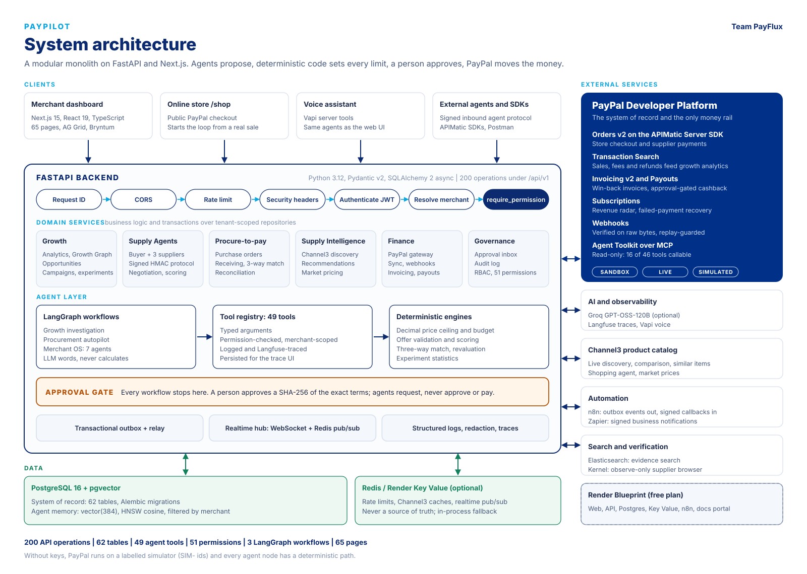
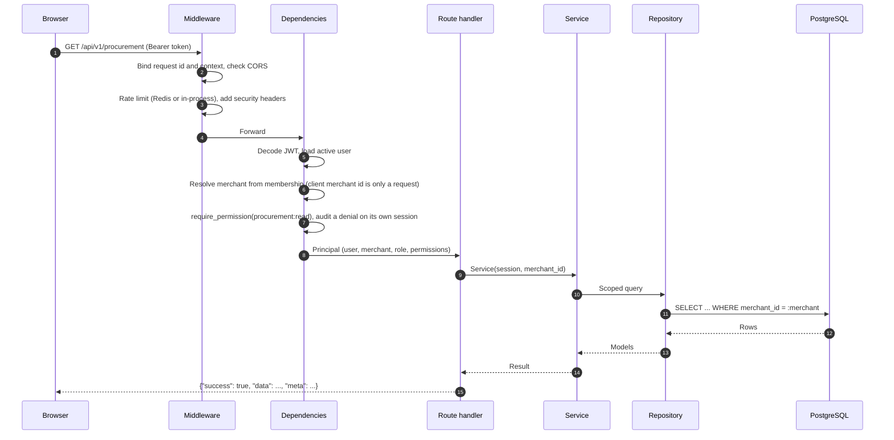
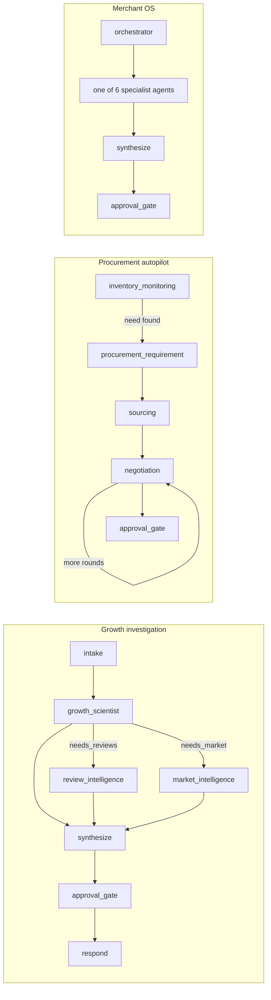
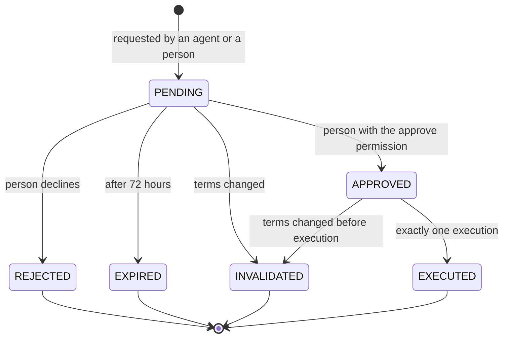
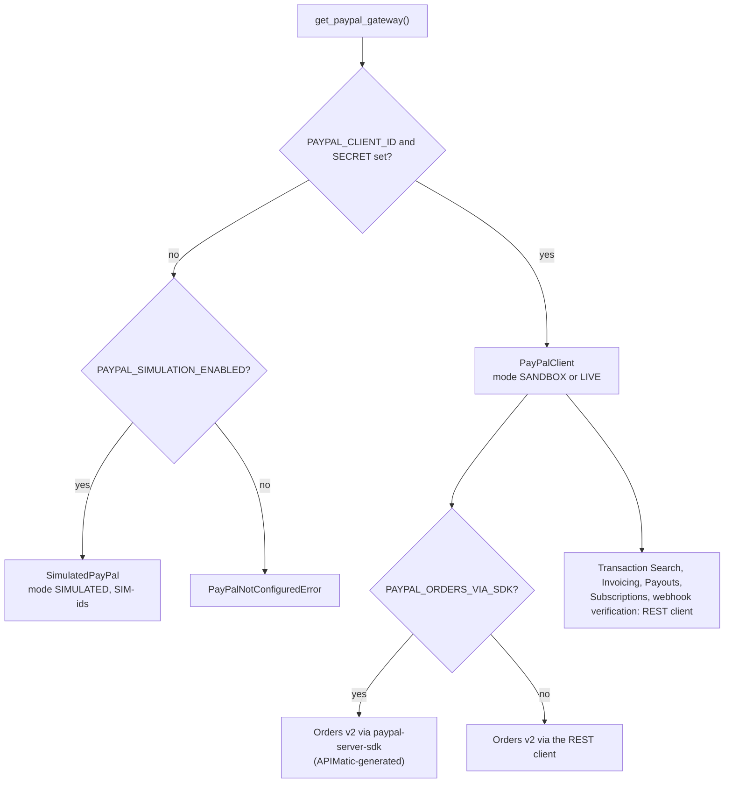
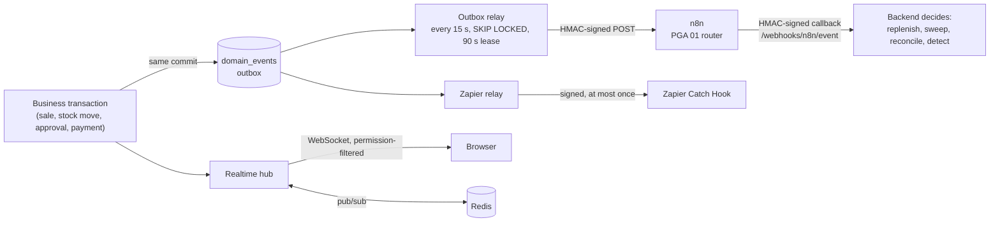

<div align="center">

# Architecture

How PayPilot is put together, how a request flows through it, and why each boundary is where it is.

[](README.md)
[](AGENTS.md)
[](SECURITY.md)
[](PAYPAL.md)
[](DATA.md)
[](API.md)

</div>

---

## Contents

- [System overview](#system-overview)
- [Design principles](#design-principles)
- [Layers and boundaries](#layers-and-boundaries)
- [Request lifecycle](#request-lifecycle)
- [Backend modules](#backend-modules)
- [Frontend](#frontend)
- [Agent layer](#agent-layer)
- [The approval gate](#the-approval-gate)
- [PayPal gateway](#paypal-gateway)
- [Events, automation and realtime](#events-automation-and-realtime)
- [Data layer](#data-layer)
- [External integrations](#external-integrations)
- [Observability](#observability)
- [Key decisions and trade-offs](#key-decisions-and-trade-offs)

---

## System overview



PayPilot is a **modular monolith**: one FastAPI service, one Next.js application and one PostgreSQL database.
The product has a single surface and a single team, so distributed-systems overhead would buy nothing; the
modularity lives in the code, where each domain owns its services, models and routes.

| Measure | Value | Source |
| --- | --- | --- |
| API operations | 200 (209 route handlers including hidden webhooks and the WebSocket) | [`docs/openapi.json`](openapi.json), [`backend/app/api`](../backend/app/api) |
| Database tables | 62 (60 models + 2 association tables) | [`backend/app/db/models`](../backend/app/db/models) |
| Agent tools | 49 | [`backend/app/tools`](../backend/app/tools) |
| LangGraph workflows | 3 (growth, procurement, Merchant OS with 7 agents) | [`backend/app/agents`](../backend/app/agents) |
| Permissions, roles | 51, 5 | [`core/permissions.py`](../backend/app/core/permissions.py) |
| Frontend pages | 65 | [`frontend/src/app`](../frontend/src/app) |
| Migrations | 8 | [`backend/alembic/versions`](../backend/alembic/versions) |

Regenerate the diagram with `python scripts/build_architecture_diagram.py`; a PNG copy is in
[`assets/architecture.png`](assets/architecture.png).

---

## Design principles

Five rules shape every module. Each is enforced in code and covered by tests.

| Rule | Enforced by |
| --- | --- |
| **The LLM never calculates a business number.** It routes, explains and proposes; every amount, limit, score and match is `Decimal` code or SQL | Tools return computed facts; the orchestrator overwrites model-provided impact and confidence; out-of-bounds negotiation proposals are refused |
| **Money moves only after a human approval bound to exact terms.** | Every workflow ends at an approval gate; approvals store a SHA-256 of the canonical terms and are re-verified at execution; agent tools for approving or paying always refuse |
| **The backend enforces all authorization.** | `require_permission` on every route; the merchant is resolved from membership; repositories filter by merchant |
| **Nothing simulated is presented as real.** | `SANDBOX` / `LIVE` / `SIMULATED` stored on every PayPal row; labelled fallbacks for every integration; `GET /integrations/status` |
| **Correlation is not causation.** | The Growth Graph has only `decomposes_into`, `correlates_with` and `evidenced_by` edges; a test fails if a causal edge is added |

A corollary of the first rule: the product works with **no LLM at all**. Every graph node has a deterministic
path, and runs that take it are labelled.

---

## Layers and boundaries

```
Next.js 15 App Router
  one Axios client: bearer token, request id, envelope unwrap, refresh-once
  TanStack Query for server state, Zustand for the session only
        |
        |  HTTPS: Authorization: Bearer <access>, HttpOnly refresh cookie; WebSocket for live inventory
        v
FastAPI
  middleware   request context -> CORS -> rate limit -> security headers
  dependencies authenticate -> resolve merchant from membership -> require_permission
  handlers     thin: validate, delegate, shape the response envelope
        |
Services       business logic, transactions, approval gates, deterministic engines
        |
Repositories   all database access, tenant-scoped by construction
        |
PostgreSQL 16 + pgvector

LangGraph agents --(registry.execute)--> Tool registry --> Services
                                         typed, permission-checked, merchant-scoped, logged, traced
```

**The layering rule:** a route handler never writes a query; a repository never contains business logic; a
service never renders a response. Agent tools are the only bridge between a model and the business, and they sit
*above* services, so an agent can never reach the database directly or widen its own scope.

---

## Request lifecycle



Middleware order is set in [`core/middleware.py`](../backend/app/core/middleware.py): the request-context
middleware runs first (request id, response timing), then CORS, the rate limiter and the security headers.
Dependencies live in [`api/deps.py`](../backend/app/api/deps.py). Errors are raised as typed exceptions
([`core/exceptions.py`](../backend/app/core/exceptions.py)) and rendered into one error envelope with a stable
`code`; see [API reference: conventions](API.md#conventions).

---

## Backend modules

| Package | Responsibility |
| --- | --- |
| [`app/api/v1`](../backend/app/api/v1) | 18 routers. Request and response schemas, permission dependencies, no business logic |
| [`app/api/realtime.py`](../backend/app/api/realtime.py) | Realtime hub: per-merchant WebSocket fan-out, filtered by the receiver's permissions, bridged across processes through Redis pub/sub |
| [`app/services`](../backend/app/services) | Domain logic: `analytics`, `growth`, `campaigns`, `experiments`, `inventory`, `supply`, `supply_intel`, `discovery`, `paypal`, `intelligence`, `integrations`, `auth`, `reviews`, `competitors`, `external` |
| [`app/repositories`](../backend/app/repositories) | Database access; `MerchantScopedRepository` filters every read and sets `merchant_id` on every create |
| [`app/db`](../backend/app/db) | SQLAlchemy 2 models, portable column types, async session management |
| [`app/agents`](../backend/app/agents) | LangGraph workflows, graph state, nodes, prompts, memory narratives |
| [`app/tools`](../backend/app/tools) | The 49-tool registry and per-agent allow-lists |
| [`app/integrations`](../backend/app/integrations) | Outbound clients: PayPal (REST client, Server SDK, simulator, MCP), Channel3, Groq, Langfuse, Vapi, Elasticsearch, Kernel, Zapier, email, embeddings, vector memory |
| [`app/core`](../backend/app/core) | Settings, security (Argon2id, JWT), permissions, middleware, rate limiting, Redis, cache, logging, exceptions |
| [`app/seed`](../backend/app/seed) | Deterministic demo dataset, supply network, calibration harness |
| [`app/worker.py`](../backend/app/worker.py) | Standalone outbox and Zapier relay process, for deployments that run it outside the API |

---

## Frontend

| Concern | Implementation |
| --- | --- |
| Routing | Next.js 15 App Router: `(auth)` for sign-in, `(dashboard)` for the product, `shop` for the public store. 65 pages |
| HTTP | One Axios client ([`lib/api/client.ts`](../frontend/src/lib/api/client.ts)): base URL, `withCredentials`, `X-Request-ID`, envelope unwrap, a single shared refresh on `401` with queued replays, normalised errors |
| Session | The access token lives in memory only; on page load the HttpOnly refresh cookie mints a new one. Zustand holds the session ([`stores/auth.ts`](../frontend/src/stores/auth.ts)) |
| Server state | TanStack Query hooks per domain ([`hooks/`](../frontend/src/hooks)) |
| Live data | WebSocket inventory stream ([`hooks/use-inventory-stream.ts`](../frontend/src/hooks/use-inventory-stream.ts)) |
| Tables and charts | AG Grid Community 36.3 for dense tables, Recharts for charts, Bryntum Gantt and Scheduler for timelines, AG Studio for merchant-built dashboards |
| Design system | Tailwind CSS with shadcn/ui primitives, light and dark themes, mode badges (`SIMULATED`, `SANDBOX`, `LIVE`) on every PayPal surface |
| Permissions | The UI hides controls the role cannot use. This is a courtesy; the backend re-derives permissions on every request |

Navigation groups the product by role: Command, Growth, Supply, Agents, Finance and Governance.

---

## Agent layer

Three LangGraph workflows share one tool registry. All three end at an approval gate.



| Workflow | File | Ends with |
| --- | --- | --- |
| Growth investigation | [`agents/graph.py`](../backend/app/agents/graph.py) | A `GrowthRecommendation` whose impact and confidence come from the deterministic detector, plus a pending approval for anything money-moving |
| Procurement autopilot | [`agents/procurement_graph.py`](../backend/app/agents/procurement_graph.py) | A `PROCUREMENT_PURCHASE` approval request for the best valid offer |
| Merchant OS | [`agents/merchant_os.py`](../backend/app/agents/merchant_os.py) | An answer and, for purchases, a `MERCHANT_PURCHASE` approval request |

Everything after the gate (purchase order, receiving, matching, payment, reconciliation, campaign launch,
experiment measurement) happens through authenticated endpoints called by a person, never as a graph edge.
Details: [Agents](AGENTS.md), [Agent memory](MEMORY.md).

---

## The approval gate

Every action that moves money or commits the merchant goes through `approval_requests`
([`services/supply/approvals.py`](../backend/app/services/supply/approvals.py)).



| Property | How |
| --- | --- |
| Bound to exact terms | The request stores the canonical terms (amount, payee, quantities, match result, policy version) and their SHA-256. Deciding and executing both rebuild the terms from live rows and compare hashes |
| Invalidation is durable | A mismatch marks the approval `INVALIDATED` on its own transaction, so a later retry cannot slip through |
| People only | Deciding requires `procurement:approve` or `payment:approve`; executing requires `payment:execute`. Agent tools `approve_purchase` and `pay_supplier_invoice` always refuse |
| Owners are not exempt | An Owner has the permission but must still record the decision |
| One execution | Execution keys (`PayPal-Request-Id`, `sender_batch_id`) derive from the approval, so a double click or retry returns the same payment |

| Approval action | Raised by | Approve permission | Execute permission |
| --- | --- | --- | --- |
| `PROCUREMENT_PURCHASE` | Procurement workflow | `procurement:approve` | - (creates the purchase order) |
| `SUPPLIER_PAYMENT` | A fully received, matched supplier invoice | `payment:approve` | `payment:execute` |
| `CASHBACK_PAYOUT` | Cashback request | `payment:approve` | `payment:execute` |
| `MERCHANT_PURCHASE` | Supply Intelligence recommendation | `payment:approve` | `payment:execute` |

Campaigns and experiments use their own approval endpoints with the same rule: `execute` returns
`409 APPROVAL_REQUIRED` without a recorded approval, for every role.

---

## PayPal gateway

Application code reaches PayPal through one function,
[`get_paypal_gateway()`](../backend/app/integrations/paypal/gateway.py), which returns an object implementing
the `PayPalGateway` protocol.



Every service persists the gateway's `mode` beside what it wrote. Money is `Decimal` end to end and serialised
in PayPal's string format. Details: [PayPal integration](PAYPAL.md).

---

## Events, automation and realtime

State changes that other parts of the system care about are written as `domain_events` rows **in the same
transaction** as the change (a transactional outbox), with a correlation id that links every record in one causal
chain.



| Piece | Behaviour |
| --- | --- |
| Outbox | Delivery is retried with backoff until n8n acknowledges; a failed delivery never loses the event |
| Relay | Claims a batch by pushing `next_attempt_at` past a 90-second lease and commits before sending, so concurrent relays take disjoint batches |
| n8n | Decides *when* and *whether* to ask the backend to act; never *what*. Business rules stay in the backend, under test |
| Callbacks | HMAC over canonical JSON in both directions; unsigned callbacks are rejected (fail closed); each event is claimed once in `processed_events`, so a replay changes nothing |
| Zapier | One `integration_deliveries` row per (event, target) with a unique constraint: at most once |
| Realtime | Each frame is filtered against the receiving user's permissions before it is sent |

Business events (`business.*`) such as `PRODUCT_DEMAND_INCREASED`, `STOCKOUT_RISK_DETECTED`,
`PURCHASE_APPROVED` and `PAYMENT_RECONCILED` feed the Command Center stream and cross-module intelligence:
demand drives procurement, procurement cost drives margin, and stockout risk down-weights growth opportunities
that would promote the affected product. Details: [Automation](AUTOMATION.md),
[Supply Agents: unified intelligence](SUPPLY_AGENTS.md#unified-intelligence).

---

## Data layer

| Store | Role |
| --- | --- |
| PostgreSQL 16 | System of record: 62 tables, UUID primary keys, `created_at` / `updated_at`, composite indexes on `(merchant_id, ...)` access paths |
| pgvector | `vector(384)` columns for agent memory (HNSW cosine index) and review search |
| Redis (optional) | Rate-limit counters, Channel3 caches, realtime pub/sub. Never a source of truth |

[`app/db/types.py`](../backend/app/db/types.py) defines portable column types (`GUID`, `JSONB`, `StringArray`,
`Vector`, `UTCDateTime`) so the same models run on PostgreSQL in production and on SQLite in tests. Status columns
are strings validated by Python constant classes rather than Postgres enums, so adding a status needs no
migration. Table groups and the demo dataset: [Data](DATA.md).

---

## External integrations

Every integration follows the same pattern:

1. One client module in [`app/integrations`](../backend/app/integrations), the only place its SDK or HTTP API is
   called.
2. Secrets stay server-side and never appear in a response, a log line or `repr()`.
3. A missing key produces a **labelled** fallback or an explicit `503` with setup steps, never a silent
   imitation.
4. None of them can move money or change a limit.
5. `GET /api/v1/integrations/status` reports, for each one, whether it is running against the real service.

Details: [PayPal integration](PAYPAL.md), [Integrations](INTEGRATIONS.md).

---

## Observability

| Signal | Implementation |
| --- | --- |
| Structured logs | [`core/logging.py`](../backend/app/core/logging.py): console or JSON; request-scoped fields (`request_id`, `user_id`, `merchant_id`, `agent_run_id`) carried in context variables; recursive secret redaction before any sink |
| Agent traces for users | `agent_runs` -> `agent_steps` -> `agent_tool_calls`, rendered as the agent trace and Agent Activity screens. Raw chain-of-thought is never captured |
| Agent traces for engineers | Langfuse: a trace per run, spans for nodes and tool calls, generations for LLM calls with token usage. Exception-safe and a no-op without keys |
| Health | `GET /api/v1/health` (database, Redis, LLM, Langfuse, Vapi, email, embeddings, logging backend) and `GET /api/v1/health/live` |
| Integration status | `GET /api/v1/integrations/status` and the `/integrations` page |

---

## Key decisions and trade-offs

| Decision | Why | Cost |
| --- | --- | --- |
| Modular monolith | One product surface; transactions span modules (a payment updates inventory value and margin in one commit) | Scaling is per process, not per module |
| Deterministic engines for every number | Amounts must be auditable and reproducible; a model can be wrong confidently | More code than asking a model |
| Approval gate as the end of every graph | Execution cannot be reached by a model, by construction | Every money step needs a human click |
| Agent memory in pgvector, not a separate service | Tenant isolation stays in SQL; no extra service or LLM in the write path | Relationship queries are tag-based, not a full graph |
| Transactional outbox for events | No event is lost or sent for a rolled-back change | Delivery is asynchronous (seconds, not milliseconds) |
| Redis optional | Runs on one process with zero extra services; shares state when scaled | Without it, limits and realtime are per process |
| SQLite-compatible models | The full test suite runs without Docker or keys | Custom column types to maintain |
| Simulator behind the same gateway | The whole product is demonstrable without PayPal credentials | The simulator keeps PayPal-side objects in memory only |

---

<div align="center">

[Previous: Deployment](DEPLOYMENT.md) | [Docs index](README.md) | [Next: Agents](AGENTS.md)

</div>
