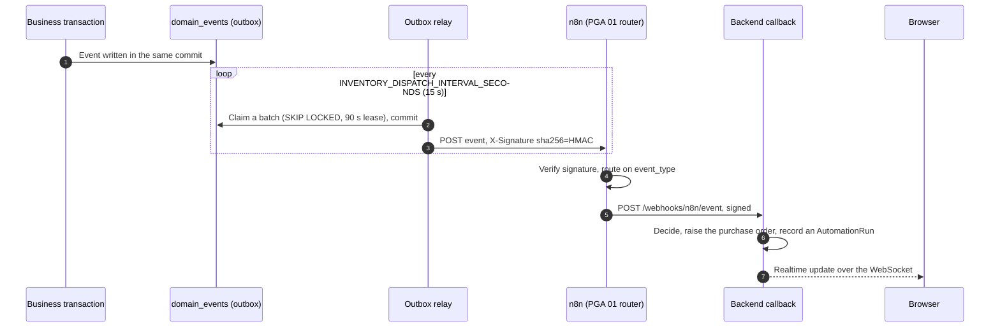

<div align="center">

# Automation

The transactional outbox, the relay that delivers it, the n8n workflows that route it, and the signed callbacks
that bring decisions back to the backend.

[](README.md)
[](ARCHITECTURE.md#events-automation-and-realtime)
[](DEPLOYMENT.md)
[](CONFIGURATION.md#inventory-automation-outbox-and-n8n)
[](https://n8n.io)

</div>

---

## Contents

- [The split of responsibilities](#the-split-of-responsibilities)
- [The loop](#the-loop)
- [What starts it](#what-starts-it)
- [Wire format and signing](#wire-format-and-signing)
- [Workflows](#workflows)
- [Deploying](#deploying)
- [On Render (free plan)](#on-render-free-plan)
- [Required settings](#required-settings)
- [Three things that are easy to get wrong](#three-things-that-are-easy-to-get-wrong)
- [Checking it works](#checking-it-works)
- [Automation API](#automation-api)

---

## The split of responsibilities

n8n is the **scheduler and router**. It decides **when** and **whether** to ask the backend to act. It never decides
**what** to do: no reorder quantity, vendor choice or approval threshold lives in a workflow node. Those rules stay
in [`backend/app/services/inventory/`](../backend/app/services/inventory), under test, on the side of the wire that
owns the data.

That split is why a workflow can be edited in the n8n UI without reviewing a business-rule change, and why the
automation behaves identically whether an event is replayed, retried or triggered by hand.

---

## The loop



Both hops are signed and every hop is idempotent. Measured end to end: about ten seconds from a sale landing to the
purchase order existing.

---

## What starts it

**The outbox relay** ([`services/inventory/relay.py`](../backend/app/services/inventory/relay.py), delivery in
[`services/inventory/events.py`](../backend/app/services/inventory/events.py)) carries events out of the backend on
a timer. It lives in the backend rather than in an n8n schedule on purpose: draining a transactional outbox is
transport, not a business decision, and it has to keep working when n8n is the thing that is down. It is the only
component that retries a failed delivery.

Each tick claims a batch by pushing `next_attempt_at` past a 90-second lease and commits before sending, so the HTTP
calls happen with no rows locked and a second relay takes a disjoint batch (`SKIP LOCKED`). The relay runs inside
the API process when `OUTBOX_RELAY_IN_PROCESS=true`, or as `python -m app.worker` otherwise (the Compose `worker`
service). With no `N8N_INVENTORY_WEBHOOK_URL`, pending events are marked `SKIPPED` so the queue cannot grow without
bound.

**Schedules inside n8n** fire business sweeps at fixed times (02:00 and 06:30). Those genuinely are business
schedules, so they belong where they can be seen and changed without a deploy.

**Flush event outbox** in the Automation Center calls the same dispatch by hand
(`POST /inventory/automation/dispatch`). It is for debugging, not correctness.

---

## Wire format and signing

The relay POSTs one event per request:

```json
{
  "event_id": "7d1c...",
  "event_type": "inventory.low_stock",
  "merchant_id": "3f2a...",
  "entity_type": "inventory_item",
  "entity_id": "9b44...",
  "correlation_id": "c-...",
  "source": "backend",
  "timestamp": "2026-11-10T18:42:07.120000+00:00",
  "payload": { }
}
```

| Header | Value |
| --- | --- |
| `X-Signature` | `sha256=<hex HMAC-SHA256 of the canonical body, keyed with N8N_WEBHOOK_SECRET>` |
| `X-Event-Id` | The event id, for de-duplication |
| `X-Correlation-Id` | Links every record in one causal chain |

The callback n8n sends back carries an `action` (`replenish`, `sweep_aging`, `reconcile`, `detect_opportunities`),
the `merchant_id`, and for `replenish` the `inventory_item_id` and originating `event_id`, signed the same way. The
backend verifies the signature before parsing and fails closed. Each event is claimed once in `processed_events`
(a unique index), so a duplicate delivery loses the race at the database.

---

## Workflows

Built by [`n8n/build_workflows.py`](../n8n/build_workflows.py), the committed source of truth.

| Workflow | Trigger | What it does |
| --- | --- | --- |
| **PGA 00 Health** | `GET /webhook/pga-health` | Answers `200` when n8n is up and the PGA workflows are registered; with `?deep=1` it also calls the backend's liveness route and answers `503` if unreachable. Carries no secret, does no work |
| **PGA 01 Inventory Event Router** | Webhook `pga-inventory-event` | Verifies the signature, routes on `event_type`: `inventory.low_stock` -> `replenish`; `inventory.expiring_soon` -> `sweep_aging`; `inventory.purchase_order_created` -> logged only; anything else acknowledged with no action |
| **PGA 02 Inventory Nightly Sweeps** | Schedule, 02:00 | Asks for `sweep_aging` and `reconcile`. Both are idempotent, so a missed night is picked up by the next run |
| **PGA 03 Daily Growth Scan** | Schedule, 06:30 | Asks for `detect_opportunities`. The detector is deterministic arithmetic over the merchant's transactions, so a daily scan costs no LLM tokens, and the upsert is idempotent |

The signed callback is served at `/api/v1/webhooks/n8n/event` and at the older alias
`/api/v1/webhooks/n8n/inventory-event`, kept for workflows already pointing at it. Both are excluded from the
OpenAPI schema.

---

## Deploying

### With Docker Compose (automatic)

`docker compose up -d --build` runs `n8n-build` (renders the workflows with
[`compose_build.py`](../n8n/compose_build.py): callback `http://backend:8000`, merchant id read from the database,
secret from `.env` or a local default), then `n8n-import` (imports and publishes them), and only then starts `n8n`,
so the webhook is registered on first boot. After a re-seed changes the merchant id:

```bash
docker compose up -d --force-recreate n8n-build n8n-import n8n
```

### Into an n8n you run yourself

```bash
./n8n/import.sh            # builds from .env, imports, restarts, confirms
./n8n/import.sh my-n8n     # if the container is not called "n8n"
```

`n8n/deploy/` is generated and git-ignored because it contains the webhook secret inline. Edit
`build_workflows.py`, never the generated JSON. The restart is required: n8n reads workflow activation only at boot.

---

## On Render (free plan)

`render.yaml` deploys n8n as `paypilot-n8n` next to the API. The loop is unchanged; only where n8n runs differs.

* **No disk, so Postgres.** n8n keeps workflows and execution history in the existing free Postgres (tables prefixed
  `n8n_`). Execution history is pruned after a week.
* **Workflows come from the repo at every boot.** [`n8n/render-start.sh`](../n8n/render-start.sh) fills in the
  secret, backend URL and merchant id from the environment, imports and publishes the workflows, then starts n8n.
  An edit made to a PGA workflow in the UI is overwritten on the next restart.
* **One shared secret.** Render generates `N8N_WEBHOOK_SECRET` once (group `paypilot-n8n-link`) for both services.
* **n8n calls the API over its public URL**, because free services have no private network.

After the first deploy:

1. On **`paypilot-n8n`** set:
   * `PGA_MERCHANT_ID`: sign in, open `GET /api/v1/merchants/current`, copy the id. Without it only the scheduled
     sweeps refuse to run.
   * `N8N_INSTANCE_OWNER_EMAIL` and `N8N_INSTANCE_OWNER_PASSWORD_HASH`: the editor is on a public URL, and an unowned
     n8n lets the first visitor claim it. The password must be a bcrypt hash:
     `python -c "import bcrypt,getpass; print(bcrypt.hashpw(getpass.getpass().encode(), bcrypt.gensalt(10)).decode())"`.
2. On **`paypilot-api`** set `N8N_INVENTORY_WEBHOOK_URL=https://<n8n host>/webhook/pga-inventory-event` and
   `N8N_BASE_URL=https://<n8n host>`. Render adds a random suffix to hostnames, so these cannot be written into the
   Blueprint.
3. Confirm with the health URLs below.

### Health URLs for an external monitor

All are unauthenticated `GET`s that reveal nothing beyond up or down.

| URL | Healthy response | Proves |
| --- | --- | --- |
| `/healthz` | `200 {"status":"ok"}` | The n8n process is up (also Render's health check) |
| `/healthz/readiness` | `200` | ... and its database is reachable |
| `/webhook/pga-health` | `200 {"status":"ok","n8n":"up","workflows":"registered"}` | ... and the PGA workflows are registered (`404` means they are not) |
| `/webhook/pga-health?deep=1` | `200 {"status":"ok","n8n":"up","backend":"reachable"}` | ... and n8n can reach the API; `503` if it cannot |

`?deep=1` waits up to 60 seconds for the API, so give a monitor a timeout of at least that.

### Keeping the schedules alive

Free services sleep after about 15 idle minutes. A webhook wakes n8n (the relay retries until it answers), but a
schedule trigger cannot fire while n8n is asleep and a missed run is not caught up. Point an external scheduler at
the deep health URL a few minutes before each run:

| When (America/Los_Angeles) | URL |
| --- | --- |
| 01:55 daily | `https://<n8n host>/webhook/pga-health?deep=1` |
| 06:25 daily | `https://<n8n host>/webhook/pga-health?deep=1` |

Do not poll more often than every 15 minutes to keep it warm: a service that never sleeps uses about 730 of the
workspace's 750 free instance-hours a month. Other limits: 512 MB is tight for n8n (the heap is capped at 384 MB so
it fails soft), and the free Postgres expires after 30 days; the workflows are rebuilt from the repo, so only
execution history is lost.

---

## Required settings

| Variable | Meaning |
| --- | --- |
| `N8N_WEBHOOK_SECRET` | Shared HMAC secret, both directions. Blank = inbound callbacks fail closed |
| `N8N_INVENTORY_WEBHOOK_URL` | Where the backend posts, for example `http://localhost:5678/webhook/pga-inventory-event` |
| `N8N_BACKEND_URL_FOR_N8N` | How n8n reaches the backend; from a container, `http://host.docker.internal:8000`, not `localhost` |
| `PGA_MERCHANT_ID` | The merchant the scheduled sweeps run for |
| `INVENTORY_DISPATCH_INTERVAL_SECONDS` | Relay interval (default 15) |
| `OUTBOX_RELAY_IN_PROCESS` | `true` to run the relay inside the API, `false` to run `python -m app.worker` |

---

## Three things that are easy to get wrong

**1. The Code nodes carry their own SHA-256.** n8n's task-runner sandbox refuses `require('crypto')` (the error is
`Module 'crypto' is disallowed`, surfacing as a failed execution rather than a bad signature), and the flag that
would allow it does not exist on n8n Cloud. So [`n8n/lib/pga-hmac.js`](../n8n/lib/pga-hmac.js) implements
HMAC-SHA256 in plain JavaScript and is inlined into every Code node at build time.

**2. Signatures cover canonical JSON, not the bytes on the wire.** The body is parsed before any n8n node sees it,
so the exact bytes are gone. Python writes an integral float as `13.0` and JavaScript writes `13`, so naive
re-serialisation would make every event look forged. Both sides serialise to a pinned form: sorted keys, no
spaces, integral floats narrowed to ints, no ASCII escaping. `canonical_json()` in
[`services/inventory/events.py`](../backend/app/services/inventory/events.py) and `canon()` in `pga-hmac.js`
**must be changed together**. The agent protocol uses the same canonicalisation.

**3. Every branch ends at a Respond node with an explicit status.** With `responseMode: responseNode`, a workflow
that fails before reaching a Respond node answers with an empty `200`, so a rejected event would be recorded as
delivered and never retried. The signature check routes failure to a `401`, and an unreachable backend routes to a
`502`, which tells the outbox to retry.

---

## Checking it works

```bash
curl -s http://localhost:5678/webhook/pga-health            # workflows registered
curl -s "http://localhost:5678/webhook/pga-health?deep=1"   # and n8n can reach the backend

curl -s -o /dev/null -w '%{http_code}\n' \
  -X POST http://localhost:5678/webhook/pga-inventory-event \
  -H 'Content-Type: application/json' -H 'X-Signature: sha256=bad' -d '{}'
# 401: the signature check is live. 404: the workflow is not active; re-run import.sh
```

In the app, the Automation Center (`/inventory/automation`) lists every run with its steps and reasoning, and
`GET /api/v1/inventory/trace/{correlation_id}` returns one causal chain: events, runs, stock movements and purchase orders.

---

## Automation API

| Method | Path | Permission |
| --- | --- | --- |
| GET | `/inventory/automation` | `automation:view` |
| GET | `/inventory/trace/{correlation_id}` | `automation:view` |
| POST | `/inventory/automation/dispatch` | `automation:manage` |
| POST | `/webhooks/n8n/event`, `/webhooks/n8n/inventory-event` | HMAC signature (hidden from the schema) |
| WS | `/inventory/stream` | Access token as a query parameter; frames filtered by permission |

---

<div align="center">

[Previous: Integrations](INTEGRATIONS.md) | [Docs index](README.md) | [Next: API portal and SDKs](APIMATIC.md)

</div>
