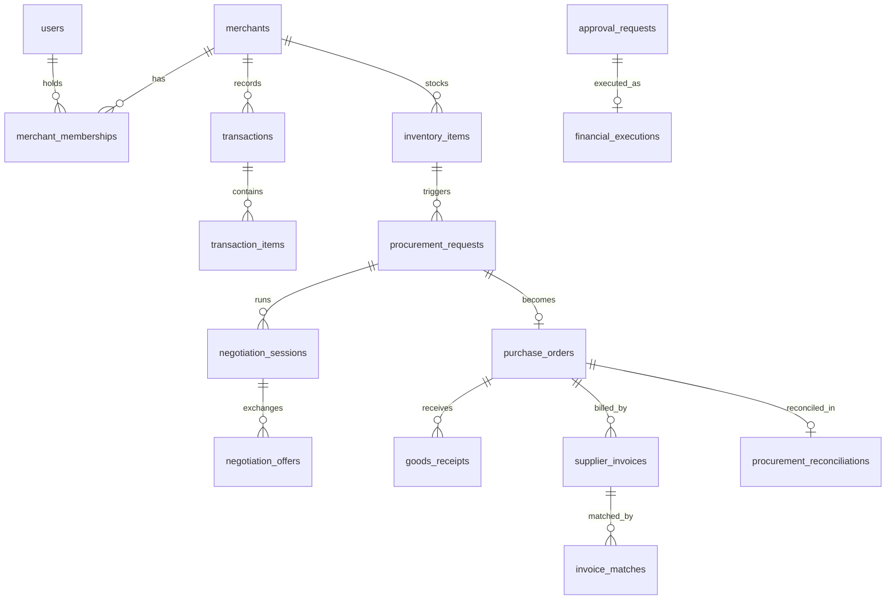

<div align="center">

# Data

The data model, migrations and portable column types, and the deterministic demo dataset that every figure in
these documents is measured from.

[](README.md)
[](ARCHITECTURE.md#data-layer)
[](TESTING.md)
[](MEMORY.md)
[](https://github.com/pgvector/pgvector)

</div>

---

## Contents

- [Data model](#data-model)
- [Conventions](#conventions)
- [Portable column types](#portable-column-types)
- [Migrations](#migrations)
- [The demo dataset](#the-demo-dataset)
- [How the story emerges from mechanisms](#how-the-story-emerges-from-mechanisms)
- [Calibration](#calibration)
- [Experiments](#experiments)
- [Supply network seed](#supply-network-seed)
- [Demo accounts](#demo-accounts)
- [Provenance labelling](#provenance-labelling)

---

## Data model

62 tables: 60 SQLAlchemy models in [`backend/app/db/models`](../backend/app/db/models) plus 2 association tables.

| Domain | Model file | Tables |
| --- | --- | --- |
| Identity and access | [`auth.py`](../backend/app/db/models/auth.py) | `users`, `roles`, `permissions`, `custom_roles`, `refresh_tokens`, `user_roles`, `role_permissions` |
| Tenancy | [`merchant.py`](../backend/app/db/models/merchant.py) | `merchants`, `merchant_memberships` |
| Audit | [`audit.py`](../backend/app/db/models/audit.py) | `audit_logs` |
| Commerce | [`commerce.py`](../backend/app/db/models/commerce.py) | `products`, `customers`, `transactions`, `transaction_items` |
| Growth | [`growth.py`](../backend/app/db/models/growth.py), [`signal.py`](../backend/app/db/models/signal.py) | `growth_metrics`, `growth_opportunities`, `external_signals` |
| Reviews and competitors | [`review.py`](../backend/app/db/models/review.py), [`competitor.py`](../backend/app/db/models/competitor.py) | `reviews`, `competitors`, `competitor_reviews` |
| Campaigns and experiments | [`campaign.py`](../backend/app/db/models/campaign.py), [`experiment.py`](../backend/app/db/models/experiment.py) | `campaigns`, `campaign_audiences`, `campaign_actions`, `experiments`, `experiment_variants`, `experiment_results` |
| Agents | [`agent.py`](../backend/app/db/models/agent.py), [`memory.py`](../backend/app/db/models/memory.py) | `agent_runs`, `agent_steps`, `agent_tool_calls`, `agent_memories` |
| Inventory | [`inventory.py`](../backend/app/db/models/inventory.py) | `inventory_items`, `inventory_movements`, `inventory_batches` |
| Vendors and purchase orders | [`procurement.py`](../backend/app/db/models/procurement.py) | `vendors`, `vendor_products`, `purchase_orders`, `purchase_order_lines` |
| Supply Agents | [`supply.py`](../backend/app/db/models/supply.py) | `supplier_agents`, `procurement_requests`, `negotiation_sessions`, `negotiation_offers`, `goods_receipts`, `supplier_invoices`, `invoice_matches`, `procurement_reconciliations` |
| Governance | [`governance.py`](../backend/app/db/models/governance.py) | `agent_messages`, `approval_requests`, `financial_executions` |
| PayPal | [`paypal.py`](../backend/app/db/models/paypal.py) | `paypal_transactions`, `paypal_sync_checkpoints`, `paypal_webhook_events`, `paypal_invoices`, `paypal_subscriptions` |
| Product discovery | [`discovery.py`](../backend/app/db/models/discovery.py) | `product_searches`, `discovered_products`, `product_comparisons`, `merchant_recommendations`, `shopping_conversations` |
| Events and automation | [`automation.py`](../backend/app/db/models/automation.py), [`integrations.py`](../backend/app/db/models/integrations.py) | `domain_events` (outbox), `processed_events`, `automation_runs`, `integration_deliveries` |

Key relationships:



---

## Conventions

* UUID primary keys; `created_at` and `updated_at` on every table.
* Every tenant-owned table has `merchant_id`, with composite indexes on the real access paths
  (`merchant_id + business_date`, `merchant_id + status`).
* Foreign keys with explicit cascade rules.
* Status columns are strings validated by Python constant classes, not Postgres enums, so adding a status needs no
  migration.
* Money is `Numeric`, handled as `Decimal` in Python.
* Every PayPal row stores `mode` (`SANDBOX`, `LIVE`, `SIMULATED`).

---

## Portable column types

[`db/types.py`](../backend/app/db/types.py) lets one model definition run on PostgreSQL and SQLite:

| Type | PostgreSQL | SQLite |
| --- | --- | --- |
| `GUID` | `UUID` | `CHAR(36)` |
| `JSONB` | `JSONB` | JSON `TEXT` |
| `StringArray` | `TEXT[]` | JSON `TEXT` |
| `Vector` | `vector(384)` | JSON `TEXT` |
| `UTCDateTime` | `TIMESTAMPTZ` | `DATETIME`, coerced to aware UTC on read |

This is why the full backend test suite runs without Docker. `UTCDateTime` exists because Postgres round-trips
timezone-aware datetimes, SQLite drops the offset, and comparing the two raises `TypeError`; fixing it in the type
keeps every call site free of defensive checks.

---

## Migrations

[`backend/alembic/versions`](../backend/alembic/versions):

| Revision | Adds |
| --- | --- |
| `0001_initial_schema` | Core schema; creates the `vector` and `pgcrypto` extensions (guarded so it runs on SQLite) |
| `0002_widen_agent_decision` | `agent_runs.decision` widened to `TEXT` |
| `0003_custom_roles` | Merchant-defined roles |
| `0004_dual_market_campaigns` | Store and online channel support for campaigns |
| `a7b8cba56c55_inventory_automation_vendors_purchase_` | Inventory automation, vendors, purchase orders, outbox |
| `0005_supply_paypal_memory` | Supply Agents, governance, PayPal tables, `agent_memories` with the HNSW index |
| `0006_integration_deliveries` | Per-target delivery state for Zapier |
| `0007_supply_intelligence` | Product discovery and recommendations |

```bash
make migrate                         # alembic upgrade head
make migration MSG="add x"           # autogenerate; read the file before applying
```

The migration template imports `app.db.types` so portable types render correctly. See
[Deployment: migrations in production](DEPLOYMENT.md#migrations-in-production).

---

## The demo dataset

**Juniper & Oak Coffee**, Portland, Oregon: a coffee shop with an online bean store. Fully deterministic from seed
`20240917` ([`app/seed/`](../backend/app/seed)).

```bash
make seed           # idempotent: skips if the demo merchant exists
make seed-reset     # remove the demo tenant and rebuild it
make calibrate      # print the figures without a database
```

| | |
| --- | --- |
| Products | 8 |
| Customers | 1,700 |
| Transactions | about 14,700 over 180 days |
| Transaction items | about 24,200 |
| Reviews | about 2,475, with embeddings |
| Competitors | 3, with about 495 reviews |
| Inventory items | 8 |
| External signals | 4 |
| Historical experiments | 2 (one SCALE, one STOP) |
| Supplier agents | 3, plus supply links and payees |

**Why it reproduces exactly.** Everything flows from `random.Random(20240917)`, and the dataset anchors on the most
recent completed Sunday rather than on "yesterday". Two consecutive 30-day windows contain different weekday mixes
depending on where they start, and weekend footfall runs about 25% above a Tuesday, which alone can swing a
period-over-period comparison by several percent. Pinning the weekday removes that.

---

## How the story emerges from mechanisms

No code says "the answer is waiting time". The generator
([`seed/generators/dataset.py`](../backend/app/seed/generators/dataset.py)) creates mechanisms; the analytics layer
finds their consequences.

| Mechanism | Parameter | Consequence the analytics find |
| --- | --- | --- |
| Customers have shape: a small core of regulars over a long tail | `LOYALTY_TIERS` (CORE 5.5% at about 4 visits a week ... RARE 76%) | A realistic repeat rate of about 38% |
| Evening regulars churn on staggered days | `EVENING_REGULAR_CHURN_PROB = 0.37` | A steady evening decline, recoverable through win-back |
| Evening baskets shrink | `EVENING_COMBO_ATTACH_DECAY = 0.28` | AOV falls independently of order count |
| Evening service slows | `EVENING_SERVICE_DRIFT_MINUTES = 6.4` | Service time correlates with the decline |
| Reviews are generated from the orders they describe | complaint probability rises with wait above a threshold | Waiting-time complaints rise without any complaint rate being set |
| Competitors are perceived as faster | per-competitor `speed` score | Competitor intelligence shows the gap |
| Premium Coffee Beans demand rises online | 7 to 12 bags a day | The supply loop: 3.5 days of cover, procure 150 |

---

## Calibration

`make calibrate` ([`seed/calibrate.py`](../backend/app/seed/calibrate.py)) generates the dataset in memory and prints
what the dashboard will show, in about three seconds and without a database. Last 30 days against the previous 30:

| Metric | Current | Previous | Change |
| --- | --- | --- | --- |
| Revenue | $24,693 | $28,124 | -12.2% |
| Orders | 2,353 | 2,473 | -4.9% |
| AOV | $10.49 | $11.37 | -7.7% |
| Repeat rate | 38.3% | 41.4% | -7.7% |
| Average service time | 7.43 min | 6.97 min | +6.6% |

| Trading slot | Revenue change | Service time change |
| --- | --- | --- |
| Morning | -3.1% | -0.4% |
| Afternoon | +0.1% | -1.8% |
| **Evening** | **-31.9%** | **+24.5%** |
| Night | +2.3% | -2.4% |

Evening waiting-time complaints rise from 11 to 21, and the negative share from 6.2% to 22.2%. Every figure is
measured from the generated ledger, not configured.

**Calibration catches what tests cannot.** An earlier generator gave customers a tenure of
`rng.randint(5, HISTORY_DAYS)`, so about 31% of customers "joined" inside the comparison window and manufactured
about +10% of apparent growth, masking the real decline. Every test passed; the data was internally consistent and
the story was simply weaker than intended. The calibration harness found it. If you change anything under
`app/seed/generators/`, run `make calibrate` and read the numbers.

The generated metrics are stochastic: a small parameter change shifts the whole RNG stream, so adjacent
configurations can differ by several percent. Tune against the fixed seed and read the realised numbers.

---

## Experiments

Both historical experiments are measured by the ordinary measurement service: transactions are written for each arm,
tagged with the experiment and variant, and aggregated exactly as live traffic would be. No result is typed in.

| Experiment | Control | Test | Lift | p | Decision |
| --- | --- | --- | --- | --- | --- |
| Weekend Brunch Combo | 9.35% | 13.85% | +48.1% | 0.038 | SCALE |
| Loyalty Chai Pass | 15.13% | 12.33% | -18.5% | 0.321 | STOP |

Converter selection is exact, not sampled: with a few hundred customers per arm, Bernoulli noise would swamp the
effect, so the generator takes exactly `round(n x rate)` customers ordered by a hash of
`experiment:variant:customer`.

When a person approves an opportunity on a demo tenant, the system writes the transactions the experiment would have
produced from a declared ground truth (control 8.8%, test x1.62, baskets x1.18), each marked
`metadata_json.simulated = true`. The measurement service is not told the ground truth; it computes conversion, lift,
incremental revenue, ROI and a two-proportion z-test from the rows.

---

## Supply network seed

[`seed/supply.py`](../backend/app/seed/supply.py) creates the three supplier agents with their private policies (see
[Supply Agents: supplier agents](SUPPLY_AGENTS.md#supplier-agents)), their supply links, registered key fingerprints
and payees (`PAYPAL_SANDBOX_PAYEE_EMAIL` when set), plus inventory policy and the Premium Coffee Beans demand spike.
[`seed/inventory_automation.py`](../backend/app/seed/inventory_automation.py) and
[`seed/operations.py`](../backend/app/seed/operations.py) add vendors, purchase orders, PayPal records and memories.

---

## Demo accounts

| Name | Email | Role |
| --- | --- | --- |
| Morgan Hayes | `owner@juniperoak.com` | Owner |
| Jordan Ellis | `admin@juniperoak.com` | Admin |
| Avery Chen | `analyst@juniperoak.com` | Analyst |
| Sam Rivera | `staff@juniperoak.com` | Staff |
| Taylor Brooks | `viewer@juniperoak.com` | Viewer |

Password for all: `Autopilot@2024`. Remove or rotate these for any deployment with real users.

---

## Provenance labelling

The demo data is fictional and the product says so:

* `merchants.is_demo` and `data_source = SEEDED`;
* `is_simulated` on reviews, competitor reviews, external signals, campaigns and experiments;
* provenance metadata on the relevant API responses;
* "Demo simulation" badges in the UI;
* `SIMULATED` mode on every simulated PayPal row; synced PayPal transactions are stored separately with their real
  mode.

---

<div align="center">

[Previous: Security](SECURITY.md) | [Docs index](README.md) | [Next: Testing](TESTING.md)

</div>
