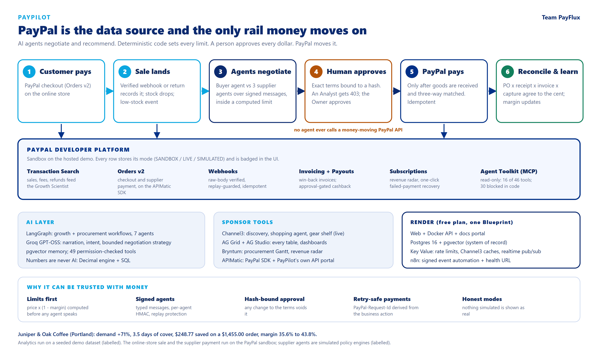

# Devpost submission draft

[Back to docs](README.md)

Paste each section into the matching Devpost field. Replace the three `<...>`
links before submitting, and keep the claims in step with
[SPONSORS.md](SPONSORS.md) - every tool listed there says whether it ran against
the real service.

---

## Tagline

An AI operating system for small merchants: agents that grow revenue, source and
negotiate stock, and settle suppliers through PayPal - with a human approving
every dollar.

## Inspiration

A small coffee shop owner is the growth analyst, the buyer and the accountant at
once. Their PayPal data already says when sales slip and which product is about to
run out, but turning that into a decision - and then into a negotiated purchase
order and a correct payment - takes hours they don't have. We wanted agents that
do that work end to end, without ever being trusted with the money.

## What it does

PayPilot runs a merchant's business loop on top of PayPal:

* **It starts with a real PayPal sale.** Juniper & Oak's online store takes a PayPal checkout; a verified
  webhook (or the customer's return) records the sale, stock drops, and the low-stock event fires - the
  loop below starts from that, not from a seeded dataset.

* **Growth:** a Growth Scientist reads PayPal transactions, finds opportunities
  (for example *capture rising demand for whole-bean coffee: 7 -> 12 bags/day*),
  and measures campaigns with controlled experiments.
* **Supply agents:** Inventory Intelligence sees the beans will run out in 3.5
  days. A Buyer Agent sends an RFQ to three independent supplier agents, each with
  private pricing, and negotiates over several rounds. Every message between
  agents is typed and HMAC-signed; every offer is checked against a limit the
  backend computed *before any agent spoke* (`$18 x (1 - 40%) = $10.80` per bag).
  The winner saves **$248.77** on a **$1,455.00** order.
* **Financial control:** an Analyst who tries to approve gets **HTTP 403**; the
  Owner approves terms bound to a hash, so any change invalidates the approval.
  Receiving 100 of 150 bags holds payment (three-way match); the last 50 release it.
* **PayPal settlement:** the supplier is paid with **PayPal Orders v2** on PayPal's
  official, APIMatic-generated Server SDK (payee = supplier, idempotency key,
  sandbox approve -> capture), then reconciled to the cent. Inventory is revalued
  and the product's margin moves **35.6% -> 43.8%**.
* **Finance:** Transaction Search sync and insights, Invoicing, approval-gated
  cashback **Payouts**, verified webhooks, and a **subscription revenue radar**
  (Bryntum Scheduler): every PayPal subscriber on one timeline - charges collected,
  the one that failed and PayPal's retries, renewals coming up - with one-click
  recovery that redraws the row.
* **Gear shelf (Channel3):** the merchant's online customers buy beans - and the
  gear to brew them, which the shop doesn't stock. PayPilot searches Channel3's
  live catalogue by category for grinders, pour-over kits, filters, mugs and
  canisters, shows real products with prices, retailers and affiliate buy links,
  and estimates the commission from the shop's measured buyers (212 in the last
  30 days) with the attach rate stated as an assumption.
* **Dashboards:** AG Grid tables everywhere, an AG Studio dashboard that opens
  pre-built and is edited by drag-and-drop, and a Bryntum Gantt of every
  procurement's real history. When a supplier's agent reports a delay - a signed
  `DELIVERY_UPDATE` over the protocol - the delivery bar and the PayPal payment
  that waits on it move right and turn red, with the original plan drawn
  underneath.

### Why PayPal is central

PayPal is the merchant's **system of record** (Transaction Search feeds every growth
insight) and the **only rail money moves on** (Orders v2 pays the supplier, Invoicing and
Payouts reach customers, Subscriptions and webhooks keep recurring revenue honest). The
agents never touch the money: they negotiate and recommend, a human approves terms bound
to a hash, a three-way match gates the payment, `PayPal-Request-Id` is derived from the
business action so a retry cannot pay twice, and PayPal's own Agent Toolkit is reachable
read-only - 16 of its 46 tools callable, the 30 that create, pay or send blocked in code.
Full mapping, with code and screens: [PROJECT_OVERVIEW.md](PROJECT_OVERVIEW.md).

## How we built it

* **Backend:** FastAPI, SQLAlchemy 2 (async), PostgreSQL 16 + pgvector, Alembic.
  Money is `Decimal` end to end; limits, scoring, matching and revaluation are
  deterministic code, never an LLM.
* **Agents:** LangGraph workflows for growth and procurement (both stop at a human
  approval gate); Groq `gpt-oss-120b` for narration, intent routing and a buyer
  strategist whose proposals are bounds-checked before use; pgvector memory.
* **PayPal:** the money-moving step (Orders v2 create / get / capture) runs on
  PayPal's **APIMatic-generated Server SDK**, written with the **APIMatic PayPal
  Context Plugin** in Claude Code - it caught real traps (a disguised 401, absent
  optional fields, retry defaults that skip POST). Our own REST client (OAuth
  caching, retries, `PayPal-Request-Id` idempotency, debug ids) covers Transaction
  Search, Invoicing, Payouts, Subscriptions and webhook verification, plus a
  labelled simulator so judges can run everything without keys. PayPal's Agent
  Toolkit is reachable read-only over MCP; every money-moving tool is blocked in
  code.
* **Frontend:** Next.js 15 + React 19, TanStack Query, AG Grid 36.3, AG Studio
  3.1, Bryntum Gantt and Scheduler 8.0 (Enterprise: baselines, time ranges). We also wired Studio's AI agent harness to our backend's LLM
  through an `AgLlmAdapter` (the key never reaches the browser); it works, but on
  Groq's free tier Studio's agents are too slow to finish a request, so the hosted
  demo keeps it switched off.
* **Ops:** Docker Compose for the whole stack including n8n, and one Render Blueprint
  that runs the product on the free plan - API, web, Postgres + pgvector, **Key Value
  (Redis)** for shared rate limits, Channel3 caches and realtime pub/sub (with an
  in-process fallback), n8n, and the APIMatic docs portal - plus a Postman collection
  and an APIMatic project for PayPilot's own API (spec, guides, SDK and Context Plugin
  config).

## Challenges we ran into

* **Keeping AI away from the money.** Agents propose; the backend disposes. Every
  offer is validated against a policy version, approvals are bound to a SHA-256 of
  the exact terms, and payment needs a second approval.
* **Signatures across languages.** Python and JavaScript serialise JSON
  differently (`13.0` vs `13`), so both sides sign a pinned canonical form.
* **Real PayPal is stricter than any mock.** The sandbox rejected INR
  (`CURRENCY_NOT_SUPPORTED`) and needed app features switched on; the sandbox MCP
  server currently errors on every tool call, which we surface as an error instead
  of pretending it worked.
* **Sponsor SDK details.** Two copies of AG Grid blanked AG Studio until both
  packages were pinned to the version Studio requires; Studio's agents send more
  tokens per turn than Groq's free tier allows per minute, so we taught the relay
  to wait out rate limits and shrink its answer budget to fit - still not enough
  for a full agent run on a free key.

## Accomplishments that we're proud of

* A complete purchase-to-pay loop where every figure is reproducible and every
  money movement has a named human approver.
* Agent-to-agent negotiation with real, persisted, verified protocol messages.
* 535 backend tests (unit, API and integration - including the full procurement
  lifecycle through the real API) plus frontend unit tests, all passing.

## What we learned

Agents are most useful when the boundary is explicit: deterministic code owns
limits and money, agents own search, negotiation and explanation, and humans own
the decision. That split also made the system far easier to test.

## What's next

Live PayPal (beyond the sandbox), real supplier endpoints speaking the signed
protocol, scheduled Studio reports, and Channel3 product subscriptions so the gear
shelf updates itself when a retailer changes a price or runs out.

## Built with

`python` `fastapi` `postgresql` `pgvector` `sqlalchemy` `langgraph` `groq`
`paypal` `paypal-orders-v2` `paypal-payouts` `paypal-invoicing` `paypal-subscriptions`
`paypal-agent-toolkit` `paypal-server-sdk` `apimatic` `mcp` `next.js` `react`
`typescript` `ag-grid` `ag-studio` `bryntum` `channel3` `n8n` `docker` `render`
`postman` `langfuse` `vapi` `redis` `elasticsearch` `kernel` `zapier`

## Links

* Live demo: <https://paypilot-web-0lqv.onrender.com> - log in as `owner@juniperoak.com` / `Autopilot@2024`
  (other roles in [DEMO.md](DEMO.md)); first load may take a minute (free plan).
* API docs (APIMatic portal): <https://paypilot-docs.onrender.com>
* API (OpenAPI / Swagger): <https://paypilot-api-bjn2.onrender.com/docs>
* Video: `<YouTube URL>`
* Code: <https://github.com/Madhur-Prakash/PayPilot>

## Testing instructions for judges

**Hosted:** open the live demo above (allow a minute for the free plan to wake). Try the customer view at
`/shop` (no sign-in), then follow [DEMO.md](DEMO.md) (three minutes). It runs against the **PayPal sandbox**, with
Channel3 live and an LLM configured; `GET /api/v1/integrations/status` lists every
integration's mode.

**Locally, no keys needed:** `docker compose up -d --build`, open <http://localhost:3000>.
PayPal then runs in a labelled simulator and agents in deterministic mode unless keys are
configured. Project overview: [PROJECT_OVERVIEW.md](PROJECT_OVERVIEW.md).

## APIMatic: Description of Context Plugin usage

(Short summary for the reviewer - paste into the APIMatic form field.)

> We installed the APIMatic PayPal Context Plugin in Claude Code and used it to move
> PayPilot's supplier payments - Orders v2 create, get and capture, the step that
> actually pays a supplier - from a hand-written REST call onto PayPal's official
> APIMatic-generated Server SDK (`paypal-server-sdk` 2.4.0). The plugin's skills
> (client initialization, authentication, calling endpoints, models, error handling,
> configuration and resilience, testing) kept the code grounded in the installed
> SDK's real source and caught traps we would otherwise have shipped: the automatic
> token fetch hides a rejected credential behind "token is undefined or expired", so
> we added a token provider that surfaces the real 401; optional model fields are
> absent rather than None and the wallet context defaults to GET_FROM_FILE /
> CONTINUE, so we set NO_SHIPPING and PAY_NOW explicitly; typed error fields can be
> unassigned when a gateway returns HTML, and AuthValidationException is not an
> ApiException, so each gets its own branch; the generated retry policy skips POST,
> so we enabled it for create and capture, safe because every write carries a
> PayPal-Request-Id. Our tests use the plugin's stub-session pattern, routed by URL
> because the OAuth token request comes first. Code:
> `backend/app/integrations/paypal/server_sdk.py`; write-up: `docs/SPONSORS.md#apimatic`.
