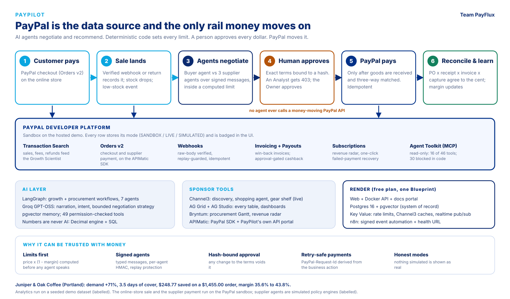
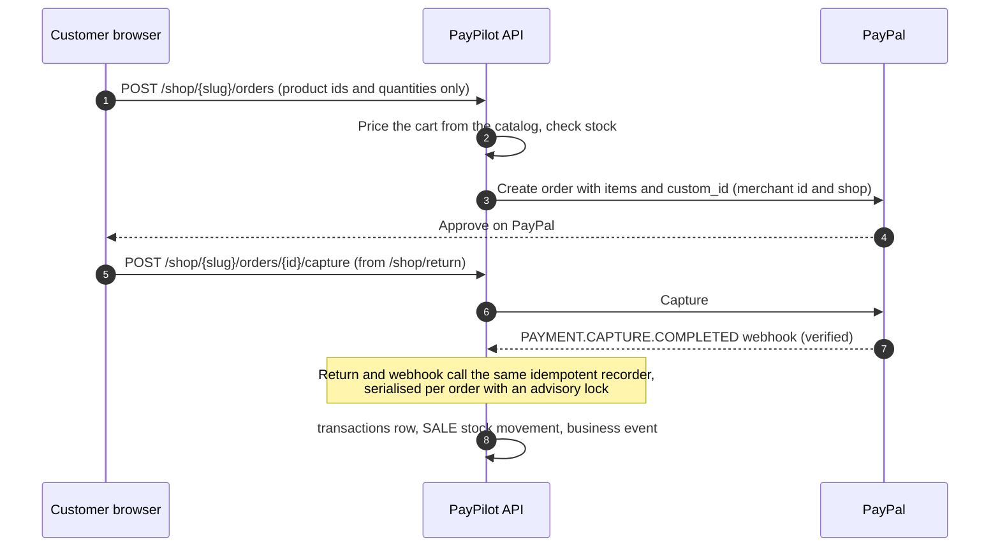

# PayPal integration

PayPal is the merchant's system of record and the only rail money moves on. This document covers every PayPal API
PayPilot calls, how each is used, and the controls around them.

---

## Contents

- [Where PayPal sits in the loop](#where-paypal-sits-in-the-loop)
- [Modes](#modes)
- [APIs used](#apis-used)
- [Customer checkout](#customer-checkout)
- [Supplier payments](#supplier-payments)
- [Reliability and money handling](#reliability-and-money-handling)
- [Transaction sync](#transaction-sync)
- [Webhooks](#webhooks)
- [Invoicing, payouts and subscriptions](#invoicing-payouts-and-subscriptions)
- [Approval gates](#approval-gates)
- [Agent Toolkit over MCP](#agent-toolkit-over-mcp)
- [Using the sandbox](#using-the-sandbox)
- [PayPal API endpoints in PayPilot](#paypal-api-endpoints-in-paypilot)
- [Verification status](#verification-status)

---

## Where PayPal sits in the loop

| Stage | PayPal capability | What it does | Code | Screen |
| --- | --- | --- | --- | --- |
| Start the loop | Orders v2 checkout + verified webhook | A customer buys from the online store; the sale is recorded, stock drops and a low-stock event fires | [`services/shop.py`](../backend/app/services/shop.py) | `/shop` |
| See the business | Transaction Search | Gross, net, fees, refunds, failures, repeat payers feed growth analytics | [`services/paypal/sync.py`](../backend/app/services/paypal/sync.py) | `/finance/transactions` |
| Pay a supplier | Orders v2 on the Server SDK | Payee = supplier; only after approval and a three-way match | [`integrations/paypal/server_sdk.py`](../backend/app/integrations/paypal/server_sdk.py) | `/finance/payments` |
| Pay for an AI-proposed purchase | Orders v2 | Approved test-stock purchases from Supply Intelligence | [`services/paypal/orders.py`](../backend/app/services/paypal/orders.py) | `/finance/payment-management` |
| Bill customers | Invoicing v2 | Win-back and wholesale invoices with reminders and cancellation | [`services/paypal/finance.py`](../backend/app/services/paypal/finance.py) | `/finance/invoices` |
| Reward customers | Payouts | Approval-gated cashback; never used for suppliers | [`services/paypal/finance.py`](../backend/app/services/paypal/finance.py) | `/finance/payouts` |
| Recurring revenue | Catalog, Plans, Subscriptions | Plans, lifecycle actions, the revenue radar with one-click recovery | [`services/paypal/radar.py`](../backend/app/services/paypal/radar.py) | `/finance/subscriptions`, `/finance/subscriptions/radar` |
| React to events | Webhooks + `verify-webhook-signature` | Settle or flag the matching record; verified first, replay-guarded, idempotent | [`services/paypal/webhooks.py`](../backend/app/services/paypal/webhooks.py) | `/finance/webhooks` |
| Let agents look | Agent Toolkit over MCP | Read-only PayPal tools through PayPilot's tool registry | [`integrations/paypal/mcp.py`](../backend/app/integrations/paypal/mcp.py) | Agent chat |
| Prove it | Reconciliation | PO, receipt, invoice and capture agree to the cent | [`services/supply/lifecycle.py`](../backend/app/services/supply/lifecycle.py) | `/supply/reconciliation` |

---

## Modes

| Mode | When | Behaviour |
| --- | --- | --- |
| `SANDBOX` | `PAYPAL_CLIENT_ID` and `PAYPAL_CLIENT_SECRET` set, `PAYPAL_ENVIRONMENT=sandbox` | Real calls to `api-m.sandbox.paypal.com` |
| `LIVE` | Credentials set, `PAYPAL_ENVIRONMENT=live` | Real calls to `api-m.paypal.com` |
| `SIMULATED` | No credentials (the default) | A deterministic in-process simulator; every id starts `SIM-`; every row and badge says Simulated |

The mode is persisted on every transaction, webhook event, invoice, subscription and payment row, and shown in the
UI. A simulated payment cannot be mistaken for a real one. The gateway is chosen once per process by
[`get_paypal_gateway()`](../backend/app/integrations/paypal/gateway.py); see
[Architecture: PayPal gateway](ARCHITECTURE.md#paypal-gateway).

---

## APIs used

| API | Endpoints | Used for |
| --- | --- | --- |
| OAuth 2.0 | `POST /v1/oauth2/token` | Client-credentials token, cached until 60 seconds before expiry, refreshed under a lock, retried once on 401 |
| Orders v2 | `POST /v2/checkout/orders`, `GET /v2/checkout/orders/{id}`, `POST .../{id}/capture`, `POST .../{id}/authorize` | Customer checkout, supplier settlement, approved purchases |
| Payments v2 | `POST /v2/payments/authorizations/{id}/capture`, `.../void` | Authorization holds captured after matching (supported; the product uses direct capture) |
| Transaction Search | `GET /v1/reporting/transactions` | Transaction intelligence |
| Invoicing v2 | `POST /v2/invoicing/invoices`, `GET .../{id}`, `POST .../send`, `.../remind`, `.../cancel`, `POST /v2/invoicing/generate-next-invoice-number` | Merchant-to-customer invoices |
| Payouts | `POST /v1/payments/payouts`, `GET .../{batch_id}` | Cashback rewards only |
| Catalog and Subscriptions | `POST /v1/catalogs/products`, `POST/GET /v1/billing/plans`, `GET /v1/billing/subscriptions/{id}`, `.../suspend`, `.../activate`, `.../cancel`, `.../revise` | Plans, lifecycle, failed-payment recovery |
| Webhooks | `POST /v1/notifications/verify-webhook-signature` | Verifying every inbound event before it is trusted |
| Agent Toolkit (MCP) | `GET https://mcp.sandbox.paypal.com/sse`, then JSON-RPC to the announced session endpoint | Read-only reporting, dispute and invoice tools |

All REST calls go through [`integrations/paypal/client.py`](../backend/app/integrations/paypal/client.py), or the
[simulator](../backend/app/integrations/paypal/simulator.py), behind the gateway protocol. Orders v2 create, get
and capture run on PayPal's APIMatic-generated Server SDK when `PAYPAL_ORDERS_VIA_SDK=true` (the default).

### Why these choices

* **Supplier invoices are paid with Orders v2, never Payouts.** Orders v2 with a `payee` is a buyer-approved
  payment to a business for a specific invoice; `invoice_id` and `custom_id` carry PayPilot's references. Payouts
  are disbursements and are reserved for cashback.
* **Authorization is a hold, not escrow.** The client supports intent `AUTHORIZE` with capture after matching;
  nothing in the product calls it escrow.
* **Invoicing is merchant to customer.** A simulated supplier has no PayPal account to invoice from, so supplier
  invoices arrive as the supplier agent's `INVOICE_ISSUED` message and are paid with Orders v2.

---

## Customer checkout

`/shop` is the customer's side of the loop: a public page (no sign-in) where someone buys the shop's online coffee
beans with PayPal. Code: [`services/shop.py`](../backend/app/services/shop.py),
[`api/v1/shop.py`](../backend/app/api/v1/shop.py).

1. The browser sends product ids and quantities, **never amounts**. The server prices the cart, checks stock and
   creates the order. A client key makes a retried click return the same order.
2. The browser return and PayPal's verified `PAYMENT.CAPTURE.COMPLETED` webhook both call the same recorder
   (`order_ref = PP-<order id>`), so whichever arrives second changes nothing, and a customer who closes the tab
   after paying is still recorded.
3. The sale becomes a `transactions` row (channel `online_store`), a `SALE` stock movement (the low-stock event
   fires when the reorder point is crossed) and a business event on the Command Center stream. If stock ran out
   between order and capture, the sale is still recorded and flagged `oversold`.

There is no extra table: PayPal holds the cart, and the sale is rebuilt from the order. Only merchants flagged
`is_demo` sell publicly, and order creation is rate limited per client address. The payee is the merchant's own
PayPal account.

---

## Supplier payments

The step that moves money out. Code: [`services/supply/lifecycle.py`](../backend/app/services/supply/lifecycle.py),
[`integrations/paypal/server_sdk.py`](../backend/app/integrations/paypal/server_sdk.py).

1. A fully received, three-way-matched invoice raises a `SUPPLIER_PAYMENT` approval bound to the exact terms.
2. A person with `payment:approve` approves; a person with `payment:execute` clicks **Pay with PayPal**.
3. PayPilot creates an Orders v2 order with the supplier as `payee`, `NO_SHIPPING`, `PAY_NOW`, and a
   `PayPal-Request-Id` derived from `supplier-invoice:{invoice}:{approval}:{attempt}:create`.
4. Simulated mode captures immediately. Sandbox: the payer approves at PayPal's approve link (a sandbox personal
   account), then a person clicks **Capture**. The order is re-read and captured only if `APPROVED`.
5. Reconciliation runs automatically once captured.

There is one live execution per invoice: paying twice returns the same execution.

### On the APIMatic-generated Server SDK

`PayPalClient.create_order`, `get_order` and `capture_order` delegate to `paypal-server-sdk` 2.4.0. The integration
was written with the APIMatic PayPal Context Plugin, which shaped several details:

| Guidance | What it changed |
| --- | --- |
| The client is long-lived | One `PaypalServersdkClient` per process, so the OAuth token and connection pool are reused |
| Map the environment explicitly | `Environment.SANDBOX` or `PRODUCTION` from `PAYPAL_ENVIRONMENT` |
| The automatic token fetch hides a real 401 | An `o_auth_token_provider` calls `fetch_token()` itself, so a rejected credential surfaces with its real status |
| Operations take one options dict and return an `ApiResponse` envelope | `create_order({"body": OrderRequest, "paypal_request_id": ..., "prefer": ...})`, payload read from the envelope |
| Optional model fields are absent, not `None` | Typed `OrderRequest`, `PurchaseUnitRequest`, `AmountBreakdown`, `PayeeBase`; `NO_SHIPPING` and `PAY_NOW` set explicitly |
| Error fields may be unassigned; auth errors are not `ApiException`; a transport error on a write means "outcome unknown" | `getattr` for typed fields; separate branches for auth and transport; transport failures reported as retry-safe with the same `PayPal-Request-Id` |
| Generated retry defaults cover GET and PUT only | POST added for create and capture, safe because every write carries a `PayPal-Request-Id` |

The SDK uses the synchronous `requests` transport, so each call runs in a worker thread (`asyncio.to_thread`).
Tests drive the real SDK serialisation through a stub `requests.Session`:
[`tests/unit/test_paypal_server_sdk.py`](../backend/tests/unit/test_paypal_server_sdk.py).

---

## Reliability and money handling

| Concern | Behaviour |
| --- | --- |
| Idempotency | `PayPal-Request-Id` on every POST that supports it, derived from the business action. Payouts use the approval id as `sender_batch_id` |
| Retries | Bounded retries with backoff on 429, 5xx and transport errors; `Retry-After` honoured |
| Diagnostics | `paypal-debug-id` captured on every response and error and stored on the execution |
| Money | `Decimal` end to end, serialised in PayPal's string format (2 decimal places; 0 for JPY, HUF, TWD). Currencies are never summed together |
| Secrets | Never logged. Errors carry PayPal's error name, message and debug id only |

---

## Transaction sync

[`services/paypal/sync.py`](../backend/app/services/paypal/sync.py)

* Transaction Search allows at most 31 days per call, so the range is split into consecutive windows of up to 31
  days and each window is paginated.
* Incremental: resumes from `paypal_sync_checkpoints.synced_until` and re-reads a 6-hour overlap, because reporting
  data can lag.
* Idempotent: rows upsert on `(merchant_id, paypal_transaction_id)`.
* Payer emails are reduced to a SHA-256 hash: enough to count repeat payers.

Trigger with `POST /api/v1/paypal/sync` (`paypal:sync`) or the `sync_paypal_transactions` agent tool.

---

## Webhooks

`POST /api/v1/paypal/webhooks` (alias `POST /api/v1/payments/webhooks/paypal`), handled by
[`services/paypal/webhooks.py`](../backend/app/services/paypal/webhooks.py).

1. **Verify first.** The raw body is embedded byte-for-byte in the `verify-webhook-signature` request
   (re-serialising can break verification). Without `PAYPAL_WEBHOOK_ID` the event is rejected. A simulator
   signature is refused by the real client.
2. **Replay guard.** `event_id` is unique; a redelivery returns `duplicate`.
3. **Idempotent handlers** for capture completed, denied, reversed and refunded; order approved; payout batch
   success and denied; invoice paid and cancelled; subscription activated, suspended, cancelled and payment failed.
4. **Failures are recorded.** A handler error marks the event `FAILED`, re-processable from Finance -> Webhooks
   (`POST /paypal/webhooks/{id}/reprocess`). Unverified events are stored as `REJECTED` and never acted on.

`POST /paypal/webhooks/simulate` (`paypal:manage`) sends a signed simulator event through the same path for local
testing.

---

## Invoicing, payouts and subscriptions

| Feature | Endpoints | Notes |
| --- | --- | --- |
| Invoices | `GET/POST /paypal/invoices`, `POST /paypal/invoices/{id}/action` (`remind`, `cancel`, `refresh`) | Merchant-to-customer, for win-back offers and wholesale orders; created and sent in one step |
| Cashback payouts | `POST /paypal/payouts/cashback`, `GET /paypal/payouts`, `POST /paypal/payouts/{id}/refresh` | Raises a `CASHBACK_PAYOUT` approval; executed only after approval |
| Plans | `GET/POST /paypal/plans` | Catalog product and billing plan |
| Subscriptions | `GET /paypal/subscriptions`, `POST /paypal/subscriptions/{id}/action` (`suspend`, `activate`, `cancel`, `recover`) | Every action is stamped into the record's history |
| Revenue radar | `GET /paypal/subscriptions/radar` | One row per subscriber, one bar per billing period, failed charges and retries as milestones, at-risk renewals; drawn with Bryntum Scheduler |

---

## Approval gates

| Money movement | Approval action | Approve permission | Execute permission |
| --- | --- | --- | --- |
| Buy from a supplier (creates the PO) | `PROCUREMENT_PURCHASE` | `procurement:approve` | - |
| Pay a supplier invoice | `SUPPLIER_PAYMENT` | `payment:approve` | `payment:execute` |
| Pay for an AI-proposed purchase | `MERCHANT_PURCHASE` | `payment:approve` | `payment:execute` |
| Send cashback payouts | `CASHBACK_PAYOUT` | `payment:approve` | `payment:execute` |

Approvals bind to a SHA-256 of the exact terms (amount, payee, match, policy version) and are re-verified at
execution. Owners are not exempt. See [Architecture: the approval gate](ARCHITECTURE.md#the-approval-gate).

---

## Agent Toolkit over MCP

PayPal publishes its Agent Toolkit as a remote MCP server with 46 tools, including tools that move money. PayPilot
connects to it **read-only**, through its own tool registry (`paypal_mcp_read`, permission `paypal:read`), so tenant
scoping, RBAC, logging and tracing still apply.

* **Transport:** HTTP+SSE. `GET /sse` with the same cached OAuth bearer token the REST client uses returns an
  `endpoint` event; JSON-RPC is POSTed to that per-session URL and replies arrive on the stream. The endpoint must
  resolve to the same host as the stream, or the call is refused, so the bearer token cannot be redirected.
* **Read-only gate, decided before any network request:** a tool is callable only if its name starts with
  `list_`, `get_`, `show_` or `search_`, contains no state-changing fragment (`create`, `pay`, `send`, `capture`,
  `cancel`, ...), and is not annotated `readOnlyHint: false`. Of the 46 tools, **16 are callable** and **30 are
  blocked** for every role, the Owner included.
* Money-moving PayPal operations stay on the approval-gated REST path.
* **Known PayPal-side issue (observed 2026-11-04):** every sandbox tool call returns
  `PAYPAL_API_SETUP_ERROR: Unsupported cache mode: default` inside a successful MCP reply. PayPilot reports it as an
  error rather than as data. Handshake, `tools/list`, argument validation and routing work.

Endpoints: `GET /integrations/paypal-mcp/tools`, `POST /integrations/paypal-mcp/call` (both `paypal:read`).

---

## Using the sandbox

1. At developer.paypal.com, open **Apps and Credentials** and create a REST app in the sandbox.
2. In `.env`: `PAYPAL_CLIENT_ID`, `PAYPAL_CLIENT_SECRET`, `PAYPAL_ENVIRONMENT=sandbox`. Restart the backend.
3. Check: `make integrations` makes one OAuth call without printing a secret; `GET /paypal/status` reports the
   mode.
4. Optional: set `PAYPAL_SANDBOX_PAYEE_EMAIL` to a sandbox **business** account and re-seed (`make seed-reset`);
   the supplier agents use it as their payee.
5. Webhooks: register `https://<your-backend>/api/v1/paypal/webhooks` for the events above (a public URL is
   needed; a tunnel works locally) and set `PAYPAL_WEBHOOK_ID`.
6. Supplier payment: approve the purchase and the payment in PayPilot, click **Pay with PayPal**, open **Approve in
   PayPal** and sign in with a sandbox **personal** account, then click **Capture**.
7. Customer checkout: open `/shop`, pay with a sandbox personal account.

---

## PayPal API endpoints in PayPilot

All under `/api/v1`.

| Method | Path | Permission |
| --- | --- | --- |
| GET | `/paypal/status`, `/paypal/transactions`, `/paypal/intelligence` | `paypal:read` |
| POST | `/paypal/sync` | `paypal:sync` |
| POST | `/paypal/webhooks` | none; signature-verified |
| GET | `/paypal/webhooks/events` | `paypal:read` |
| POST | `/paypal/webhooks/simulate`, `/paypal/webhooks/{id}/reprocess` | `paypal:manage` |
| GET | `/paypal/invoices`, `/paypal/payouts`, `/paypal/subscriptions`, `/paypal/subscriptions/radar`, `/paypal/plans` | `paypal:read` |
| POST | `/paypal/invoices`, `/paypal/invoices/{id}/action`, `/paypal/payouts/cashback`, `/paypal/payouts/{id}/refresh`, `/paypal/plans`, `/paypal/subscriptions/{id}/action` | `paypal:manage` |
| POST | `/payments/orders`, `/payments/capture`, `/payments/{id}/capture`, `/supplier-invoices/{id}/pay` | `payment:execute` |
| GET | `/payments`, `/payments/orders/{id}`, `/payments/history` | `paypal:read` |
| POST | `/payments/webhooks/paypal` | none; signature-verified |
| GET | `/shop/{slug}`; POST `/shop/{slug}/orders`, `/shop/{slug}/orders/{id}/capture` | public, rate limited |

---

## Verification status

| Path | Verified against |
| --- | --- |
| OAuth | Live PayPal sandbox |
| Orders v2 supplier payment (create, buyer approval, capture) on the Server SDK | Live PayPal sandbox |
| Customer checkout | 20 tests against the simulator, including webhook-before-return and return-before-webhook |
| Transaction Search, Invoicing, Payouts, Subscriptions, webhook verification | Simulator and mocked PayPal responses ([`tests/unit/test_paypal_client.py`](../backend/tests/unit/test_paypal_client.py), [`tests/api/test_paypal_api.py`](../backend/tests/api/test_paypal_api.py)) |
| MCP bridge | Handshake and `tools/list` against the live sandbox |

Other limits: Transaction Search data can lag several hours; the simulator keeps PayPal-side objects in memory, so
restarting the API forgets simulated orders (PayPilot's own rows persist); campaign messages use PayPilot's own
email adapter, not PayPal.

---

[Previous: Supply Intelligence](SUPPLY_INTELLIGENCE.md) | [Docs index](README.md) | [Next: Integrations](INTEGRATIONS.md)

