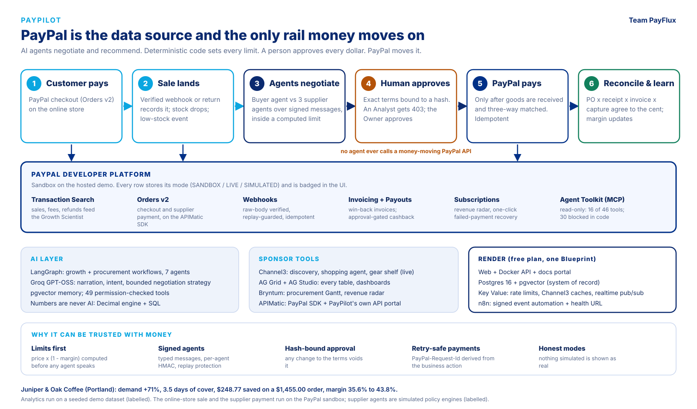

# Project overview

[Back to docs](README.md)



What PayPilot is, why PayPal is central to it, how every sponsor tool is used, and what is verified - in the order an evaluator will want it. Each claim links to the
code or document that backs it, and says whether it ran against the real service or a
labelled stand-in. If anything here disagrees with the running app, the app wins -
`GET /api/v1/integrations/status` reports the same facts live.

| | |
| --- | --- |
| **Live demo** | <https://paypilot-web-0lqv.onrender.com> - `owner@juniperoak.com` / `Autopilot@2024` (other roles in [DEMO.md](DEMO.md)). Free plan: **the first load can take about a minute** while Render wakes the services |
| **Demo video** | `<YouTube URL>` (under 3 minutes) |
| **Code** | <https://github.com/Madhur-Prakash/PayPilot> - MIT, [LICENSE](../LICENSE) |
| **API (Swagger)** | <https://paypilot-api-bjn2.onrender.com/docs> - 200 operations |
| **API portal (APIMatic)** | <https://paypilot-docs.onrender.com> |
| **Run it yourself** | [Section 9](#9-run-it-yourself) - no keys needed |
| **Three-minute walkthrough** | [DEMO.md](DEMO.md) |

**What the hosted demo is running** (read from `GET /api/v1/integrations/status` and
`/health` on 2026-11-09 - the demo credentials above can reproduce this):

| PayPal | PayPal MCP | Channel3 | Kernel | AG Studio | Bryntum | AI (Groq) | Langfuse | Redis (Render Key Value) | Elasticsearch | Zapier |
| :-: | :-: | :-: | :-: | :-: | :-: | :-: | :-: | :-: | :-: | :-: |
| **SANDBOX** | SANDBOX | **LIVE** | LIVE | LIVE | LIVE | configured | configured | ok | off (labelled) | off (labelled) |

---

## 1. The idea in thirty seconds

A small merchant is the growth analyst, the buyer and the accountant at once. PayPal
already holds the data that says *what is selling and what is about to run out* - and it
is the only place the money can move. PayPilot closes that loop with AI agents:

> A customer **pays with PayPal** on the online store **->** the sale lands and stock drops **->** growth agent finds a demand spike **->** inventory agent sees the
> stock will run out in 3.5 days **->** a buyer agent negotiates with three supplier
> agents over signed messages **->** a human approves the exact terms **->** goods are
> received and three-way matched **->** **PayPal pays the supplier** **->** the payment is
> reconciled to the cent and the product's margin updates.

**Agents negotiate and recommend. They can never pay.** A person approves every dollar,
and the approval is bound to a hash of the exact terms.

The concrete numbers in the seeded demo (Juniper & Oak Coffee, Portland; after a customer buys 2 bags at the online store they become 160 bags, $1,552.00, $262.69 saved and margin 35.6% to 44.0%, see [DEMO.md](DEMO.md)): demand **+71%**
(7 -> 12 bags/day), **3.5 days** of cover, a deterministic ceiling of `$18.00 x (1 - 40%) =
$10.80` per bag, a negotiated order of **$1,455.00** that is **$248.77** below the best
opening quote, and a product margin that moves **35.6% -> 43.8%**.

---

## 2. Why PayPal is central (not decoration)

PayPal is the merchant's **system of record** (what sold, what failed, what was refunded)
and the **only rail** money moves on. Take it away and the product has no data to reason
over and no way to act. It appears at every stage of the loop:

| Stage of the loop | PayPal capability | What it does for the merchant | Code | Screen |
| --- | --- | --- | --- | --- |
| **Start** the loop | **Orders v2** checkout + **verified webhook** | A customer buys the shop's beans with PayPal. The browser return *and* PayPal's `PAYMENT.CAPTURE.COMPLETED` webhook both record the sale, idempotently, so a customer who closes the tab after paying is still recorded. The sale becomes a transaction, drops stock through the stock engine and raises the low-stock event - **the loop starts from a real PayPal sale, not a seeded one** | [`services/shop.py`](../backend/app/services/shop.py), [`api/v1/shop.py`](../backend/app/api/v1/shop.py) | `/shop`, `/shop/return` |
| **See** the business | **Transaction Search** (`/v1/reporting/transactions`) | Gross/net, fees, refunds, failures, AOV, repeat payers feed growth analytics and the Growth Scientist. Synced incrementally in <=31-day windows with checkpoints | [`services/paypal/sync.py`](../backend/app/services/paypal/sync.py) | `/finance/transactions` |
| **Pay a supplier** | **Orders v2** (create -> buyer approves -> capture) on PayPal's **APIMatic-generated Server SDK** | The step that moves money: supplier is the payee, the invoice and approval ids travel in `invoice_id` / `custom_id`, and capture only happens after goods are received and matched | [`integrations/paypal/server_sdk.py`](../backend/app/integrations/paypal/server_sdk.py), [`services/paypal/orders.py`](../backend/app/services/paypal/orders.py) | `/finance/payments` |
| **Bill customers** | **Invoicing v2** | Win-back offers and wholesale invoices with reminders and cancellation | [`services/paypal/finance.py`](../backend/app/services/paypal/finance.py) | `/finance/invoices` |
| **Reward customers** | **Payouts** | Approval-gated cashback only - never used for suppliers | `services/paypal/finance.py` | `/finance/payouts` |
| **Recurring revenue** | **Catalog, Plans, Subscriptions** | Plans, lifecycle actions and failed-payment recovery; the **revenue radar** shows every subscriber on one timeline with one-click recovery | [`services/paypal/radar.py`](../backend/app/services/paypal/radar.py) | `/finance/subscriptions`, `/finance/subscriptions/radar` |
| **React to events** | **Webhooks** + `verify-webhook-signature` | Captures, refunds, payouts, invoices and subscription events settle or flag the matching record - verified first, replay-guarded, idempotent | [`services/paypal/webhooks.py`](../backend/app/services/paypal/webhooks.py) | `/finance/webhooks` |
| **Let agents look** | **Agent Toolkit over MCP** (read-only) | PayPal's own reporting, dispute and invoice read tools, reached through PayPilot's tool registry so RBAC, tenant scoping and tracing still apply | [`integrations/paypal/mcp.py`](../backend/app/integrations/paypal/mcp.py) | agent chat, `/agents` |
| **Prove it** | Reconciliation | PO x receipt x invoice x capture agree to the cent; inventory is revalued; supplier reliability is updated | `services/supply/lifecycle.py` | `/supply/reconciliation` |

About 5,000 lines sit behind this ([`integrations/paypal/`](../backend/app/integrations/paypal/),
[`services/paypal/`](../backend/app/services/paypal/), [`api/v1/paypal.py`](../backend/app/api/v1/paypal.py)),
behind one gateway interface that has a real client, the official SDK path and a labelled
simulator. API-by-API detail: [PAYPAL.md](PAYPAL.md).

### How it helps

* **Decisions come from the merchant's own PayPal data**, not a generic dashboard: the
  demand spike, the failing subscription and the repeat-payer rate are all PayPal facts.
* **Cash leaves only when it should.** Payment is gated behind a human approval *and* a
  three-way match, so a partial delivery (100 of 150 bags) holds the money and the rest
  releases it.
* **The books close themselves.** Every payment reconciles to a PO, a receipt and an
  invoice, and flows back into inventory value and product margin.

### What is unique about the PayPal use

1. **AI that can spend money without being trusted with it.** Agents propose; the backend
   disposes. The agent tools for approving or paying *always refuse*, and an Analyst who
   tries to approve gets **HTTP 403** - Owners are not exempt.
2. **Approvals bound to exact terms.** Each approval stores a SHA-256 of the canonical
   details (amount, payee, match, policy version) and is re-verified at execution; any
   change invalidates it.
3. **A retried request can never pay twice.** `PayPal-Request-Id` is derived from the
   business action (`supplier-invoice:{invoice}:{approval}:{attempt}:create`), payouts use
   the approval id as `sender_batch_id`, and there is one live execution per invoice.
4. **Webhooks are verified on the raw bytes.** The body is embedded byte-for-byte in
   PayPal's verify call (re-serialising can break verification); no `PAYPAL_WEBHOOK_ID`
   means reject; the event id is a replay guard; unverified events are stored as
   `REJECTED` and never acted on.
5. **PayPal's Agent Toolkit, safely.** Of the 46 tools PayPal's MCP server exposes, **16
   read tools are callable and 30 are blocked in code before any network request** -
   everything that creates an order, pays, refunds, sends an invoice or accepts a dispute.
6. **Money is `Decimal` end to end** in PayPal's string format (0 dp for JPY/HUF/TWD),
   and currencies are never summed together.
7. **Nothing simulated is presented as real.** `SANDBOX` / `LIVE` / `SIMULATED` is stored
   on every transaction, webhook, invoice, subscription and payment row and badged in the UI.
8. **Built with the APIMatic PayPal Context Plugin**, which caught real traps (a disguised
   401, absent optional fields, retry defaults that skip POST) - see
   [SPONSORS.md](SPONSORS.md#apimatic).

---

## 3. Where the AI is - and where it deliberately is not

| | |
| --- | --- |
| **LangGraph** | Two workflows - growth and procurement - and seven agents on one graph: an Orchestrator plus Business Intelligence, Product Discovery, Supply Intelligence, Pricing Intelligence, Growth Strategy and PayPal Transaction agents. Both workflows **stop at a human approval gate** |
| **Groq GPT-OSS-120B** | Growth narration, intent routing, and the **buyer agent's negotiation strategist** - whose proposals are bounds-checked by the backend (an out-of-bounds counter is refused, not clamped) |
| **Agent-to-agent protocol** | Three supplier agents with private pricing, stock and behaviour; typed, schema-versioned messages, **per-agent HMAC**, freshness, replay protection and tenant checks at one verification boundary ([SUPPLY_AGENTS.md](SUPPLY_AGENTS.md)) |
| **pgvector memory** | Agents remember outcomes (HNSW cosine, tenant isolation in SQL) ([MEMORY.md](MEMORY.md)) |
| **Channel3 shopping agent** | Multi-turn conversational product search |
| **Tool registry** | 49 permission-checked, traced tools; every call appears in Agent Activity |
| **Voice (Vapi), tracing (Langfuse)** | Optional; configured on the hosted demo |
| **Not AI, on purpose** | Every amount, limit, score, three-way match and revaluation is deterministic `Decimal` code or SQL. The model explains and proposes; it never calculates a figure or approves a dollar |

Without an LLM key every graph node has a deterministic path and runs say *Deterministic
mode*. The hosted demo has the LLM configured.

---

## 4. The features that matter most

| # | Feature | Why it stands out | See it |
| :-: | --- | --- | --- |
| 0 | **A real PayPal sale starts the loop** | A customer pays at the online store; the sale is recorded, stock drops, a low-stock event fires, and the Reorder screen shows the new cover - all from a PayPal capture | `/shop` -> `/supply/reorder` |
| 1 | **Agent-to-agent negotiation** | Three independent supplier agents and a buyer agent negotiate over several rounds; every message is a persisted, HMAC-verified protocol message and every offer carries the backend's verdict | `/supply/negotiations/{id}` -> *Agent conversation* |
| 2 | **Limits computed before any agent speaks** | `price x (1 - margin)` ceiling and a budget, from a deterministic engine | `/supply/reorder` -> *Policy...* |
| 3 | **Human approval bound to exact terms** | 403 for an Analyst; the Owner approves a hash; any change voids it | `/approvals` |
| 4 | **Payment gated by three-way match** | Partial receipt holds PayPal payment; full receipt releases it | `/supply/receiving` |
| 5 | **Real PayPal sandbox payment** | Create -> buyer approves in PayPal -> capture, on the official SDK, idempotent | `/finance/payments` |
| 6 | **Reconciliation to the cent** | PO x receipt x invoice x capture; inventory revalued; margin moves 35.6% -> 43.8% | `/supply/reconciliation`, `/command` |
| 7 | **Procurement Gantt with agent-driven rescheduling** | A supplier agent's signed `DELIVERY_UPDATE` moves the delivery *and the PayPal payment that waits on it*, drawn red against the original plan | `/supply/timeline` |
| 8 | **Subscription revenue radar** | Every PayPal subscriber on one timeline: collected, failed, retried, at-risk, one-click recovery | `/finance/subscriptions/radar` |
| 9 | **Live product intelligence** | Natural-language product discovery and a gear shelf of real Channel3 products with affiliate links and an honest commission estimate | `/discovery`, `/shelf` |
| 10 | **Always-on automation** | Inventory events flow through a transactional outbox to n8n (HMAC both ways) and back; a daily growth scan runs with no LLM tokens | [n8n/README.md](../n8n/README.md) |
| 11 | **Honest by construction** | Mode badges on every PayPal row, labelled simulators, and a live integrations status endpoint | `/integrations`; `GET /api/v1/integrations/status` |

---

## 5. criteria -> where to look

| Criterion | The case | Evidence |
| --- | --- | --- |
| **Technological implementation** | Deep, non-trivial PayPal and AI use: 8 PayPal capabilities, the official Server SDK, idempotency keys, raw-body webhook verification, a gated MCP bridge; LangGraph workflows, a signed agent protocol, pgvector memory | 200 API operations, 62 tables, 49 agent tools, 51 permissions, **535 backend tests** (unit, API, integration - including the full procurement lifecycle through the real API) plus frontend tests; [ARCHITECTURE.md](ARCHITECTURE.md), [SECURITY.md](SECURITY.md), [TESTING.md](TESTING.md) |
| **Design** | One coherent product, not a technical demo: role-based navigation (Command / Growth / Supply / Agents / Finance / Governance), a design system with light and dark themes, 50+ screens, live status badges, empty states that explain themselves | Open the app; [DEMO.md](DEMO.md) |
| **Potential impact** | A named persona with a specific, measurable pain: a coffee shop that finds out it is out of stock after the fact and pays a quote it never negotiated. The demo quantifies it - $248.77 saved on one order, margin +8.2 points, 3.5 days of stock risk caught | [Section 1](#1-the-idea-in-thirty-seconds); [DATA.md](DATA.md) says exactly what is seeded vs synced |
| **Innovation / idea** | Agents that negotiate with each other on a signed protocol, inside deterministic limits, with humans approving hash-bound terms and PayPal settling only after a three-way match - a safe pattern for *agentic commerce* | [SUPPLY_AGENTS.md](SUPPLY_AGENTS.md), [Section 2](#what-is-unique-about-the-paypal-use) |
| **Presentation** | One loop, told end to end in under three minutes | Video; [DEMO.md](DEMO.md) is the shot list |

---

## 6.categories

| Category | Why PayPilot fits | Read |
| --- | --- | --- |
| **Best Use of PayPal + AI** | PayPal is the data source and the payment rail; AI finds, negotiates and explains; deterministic code and humans control the money | [Section 2](#2-why-paypal-is-central-not-decoration), [PAYPAL.md](PAYPAL.md) |
| **Best Use of Agentic Commerce** | Buyer and supplier agents transact over a signed protocol under hard limits; agents can request but never approve or pay; external agents can join through the signed inbound endpoint | [SUPPLY_AGENTS.md](SUPPLY_AGENTS.md) |
| **Best Use of Render** | A full Blueprint on the free plan: web, Docker API, Postgres + pgvector, **Key Value (Redis)**, n8n, a static docs portal | [Render](#render) |
| **Best Use of Channel3** | Product discovery, supply intelligence, a conversational shopping agent, the gear shelf, and a market price reference - on the live catalog | [Channel3](#channel3) |
| **Best Use of AG Grid** | Every dense table, themed in light and dark - plus AG Studio dashboards | [AG Grid and AG Studio](#ag-grid-and-ag-studio) |
| **Best Use of APIMatic** | Supplier payments run on the APIMatic-generated PayPal SDK, written with the Context Plugin - and PayPilot's own API is published through APIMatic | [APIMatic](#apimatic) |
| **Best Use of Bryntum** | A procurement Gantt with baselines and agent-driven rescheduling, and a Scheduler-based revenue radar | [Bryntum](#bryntum) |
| **Most Impactful / Most Creative / Best Demo** | [Section 5](#5-criteria---where-to-look); [DEMO.md](DEMO.md) | |

---

## 7. How each sponsor tool is used

Each row says **where** it is in the product, **how** it is used, and **what state it is
in on the hosted demo**. Full detail and how each was verified: [SPONSORS.md](SPONSORS.md).

### PayPal

See [Section 2](#2-why-paypal-is-central-not-decoration). Hosted demo: **SANDBOX**.

### Render

| Resource (all free plan, `render.yaml`) | What it does here |
| --- | --- |
| `paypilot-api` - Docker web service | FastAPI. Start script runs migrations, the idempotent demo seed, then serves on `$PORT`; health check `/api/v1/health`; also runs the outbox and Zapier relays in-process so no paid worker is needed |
| `paypilot-web` - Node web service | Next.js 15 |
| `paypilot-db` - managed Postgres 16 | Application data **and pgvector** agent memory (the first migration enables the extension) |
| `paypilot-redis` - **Key Value** (Redis-compatible), private (`ipAllowList: []`), `allkeys-lru` | **Four jobs:** shared HTTP rate-limit counters; the per-merchant Channel3 call budget; the Channel3 caches (every miss spends credits, and a free service restarts on every deploy and idle sleep); and **pub/sub** so realtime events reach browsers on any API instance during a deploy overlap. Never a source of truth, so the free plan's lack of persistence costs only a cold cache. **Falls back to in-process state if it is unreachable** - [CONFIGURATION.md](CONFIGURATION.md#redis). Hosted `/health` reports `redis: ok` |
| `paypilot-n8n` - Docker web service | The automation engine, defined for the free plan: state in the free Postgres (no disk), workflows rebuilt from the repo at boot, a generated shared HMAC secret, and unauthenticated **health URLs** for an external monitor - [n8n/README.md](../n8n/README.md#on-render-free-plan) |
| `paypilot-docs` - static site | The APIMatic developer portal, rebuilt on deploy |

Also: an **env group** with generated secrets, `fromDatabase` / `fromService` wiring so no
connection string is hand-copied, and a design that is explicit about free-plan behaviour
(sleep, wake, ephemeral disk, 750 instance-hours) instead of hoping it away.
Files: [`render.yaml`](../render.yaml), [`backend/scripts/render-start.sh`](../backend/scripts/render-start.sh),
[`backend/app/core/redis.py`](../backend/app/core/redis.py), [`n8n/`](../n8n/). Deployment guide: [DEPLOYMENT.md](DEPLOYMENT.md#render-blueprint).

### Channel3

| Where | How |
| --- | --- |
| `/discovery`, `/supply/intelligence` | **Product Discovery**: a natural-language request ("wireless earbuds under Rs 5,000") becomes a real `/v1/search` with brand, category, price and retailer filters; results are ranked with the reasons shown. **Compare**, **similar** (`/v1/similar`, with the documented title-search fallback), **URL enrichment** (`/v1/lookup`) and a multi-turn **shopping agent** (`/v1/conversations`) |
| `/supply/intelligence` | **Supply Intelligence**: assortment expansion, alternatives to existing products, market price intelligence, and recommendations with a visible lifecycle (Detected -> Analyzed -> Recommended -> Approved -> Executed -> Measured), each with evidence, an impact *estimate* and its assumptions |
| `/shelf` | **Gear shelf**: for the best-selling online product, one filtered search per slot (grinders, brewers, filters, mugs, storage) returns live products with **affiliate-tracked links**; the page estimates commission from the *measured* number of recent buyers and a *labelled-as-assumption* attach rate |
| Purchase approvals | **Market price reference** beside a purchase, as context for the human approving - never an input to a limit. Only shown when results agree on a category (semantic search can return nonsense; the app says so rather than averaging it) |
| Throughout | Requests carry `x-user-id: paypilot-<merchant>` so clicks and sales show up in Channel3's reporting; discovery is throttled per merchant; responses are cached in Render Key Value to save credits |

Hosted demo: **LIVE**. Without a key these routes answer `503` with setup steps - they
**never invent products**. Built with Channel3's official agent skill; verified against
the live API. Code: [`integrations/sponsors/channel3_catalog.py`](../backend/app/integrations/sponsors/channel3_catalog.py),
[`services/discovery/`](../backend/app/services/discovery/), [`services/integrations/shelf.py`](../backend/app/services/integrations/shelf.py).

### AG Grid and AG Studio

| | |
| --- | --- |
| **AG Grid Community 36.3** | Every data-heavy table: transactions, quotes, supplier invoices, receipts, reconciliation, payments, payouts, invoices, subscriptions, webhooks, RFQs and evidence - themed to the design system in light and dark. Screens under `frontend/src/app/(dashboard)/finance/` and `supply/` |
| **AG Studio** (`/studio`) | **Dashboard Studio**: opens on a pre-built overview and the merchant edits it by drag-and-drop, over datasets the **backend computes and permission-filters** (Studio derives no financial figure). Studio's AI agent harness runs on PayPilot's LLM through an `AgLlmAdapter` ([`lib/studio/llm-adapter.ts`](../frontend/src/lib/studio/llm-adapter.ts)); the key never reaches the browser and the agents' tools act on the dashboard only |

Hosted demo: AG Studio **LIVE** (evaluation mode - a watermark without a licence key). The
**Studio AI assistant is switched off on the hosted demo**: on Groq's free tier a single
request ran 16 turns over about nine minutes without finishing, so it needs a provider with
more quota. The dashboard and the drag-and-drop editor need no LLM.

### Bryntum

| Component | Where | What |
| --- | --- | --- |
| **Gantt** (8.0 Enterprise) | `/supply/timeline` | Every procurement as a parent task whose children are the stages that *actually happened*, chained RFQ -> approval -> PO/delivery -> invoice -> PayPal payment. Goods receipts are milestones, so a partial delivery is two diamonds and a half-filled bar. **Baselines** show planned vs actual. **Agent-driven rescheduling:** a supplier agent's signed `DELIVERY_UPDATE` moves the delivery and the payment that waits on it. Read-only by design - nothing can imply a commitment the backend did not make |
| **Scheduler** (8.0 Enterprise) | `/finance/subscriptions/radar` | The subscription revenue radar: one row per PayPal subscriber, one bar per billing period, failed charges and PayPal's retries as milestones, at-risk renewals dashed, one-click **Recover payment** |

Hosted demo: **LIVE** on a registered trial key (valid to 2026-12-20), which shows
Bryntum's Trial badge. Code: [`components/supply/procurement-gantt.tsx`](../frontend/src/components/supply/procurement-gantt.tsx),
[`components/finance/subscription-radar.tsx`](../frontend/src/components/finance/subscription-radar.tsx).

### APIMatic

Two directions. **Consuming:** supplier payments (Orders v2 create / get / capture) run on
PayPal's official **APIMatic-generated Server SDK** (`paypal-server-sdk` 2.4.0), written with
the **APIMatic PayPal Context Plugin** in Claude Code, which caught real traps (token fetch
hiding a 401, absent-not-`None` optional fields, retry defaults that skip POST) - code in
[`integrations/paypal/server_sdk.py`](../backend/app/integrations/paypal/server_sdk.py), tests
in `tests/unit/test_paypal_server_sdk.py`. **Publishing:** PayPilot's own API is an APIMatic
project in [`apimatic/`](../apimatic/) - spec (validated with 0 errors), four guides, Python
and TypeScript SDKs and a Context Plugin definition - so an external supplier agent can
integrate with PayPilot the way PayPilot integrated with PayPal. The `paypilot-docs` service
rebuilds and hosts the portal. Status row: `SDK`.

### Postman

[`postman/PayPilot.postman_collection.json`](../postman/PayPilot.postman_collection.json) -
59 requests with assertions, plus a local environment. The checks that matter: a write tool
returns `403`, an unsafe portal URL returns `400`, and responses never contain secrets.

### Elasticsearch, Kernel, Zapier (optional, labelled)

| Tool | Where | How | Hosted demo |
| --- | --- | --- | --- |
| **Elasticsearch** | `/search` | One ranked **evidence search** over the audit log, signed agent messages, offers, procurements, invoices, events and reviews - each source requiring the permission that protects it, always filtered by merchant | off - the same search runs on a labelled keyword fallback |
| **Kernel** | Supplier pages | Opens a cloud browser on a supplier's *public https* page so the merchant can watch it live. **Observe only** - never logs in, fills a form or pays; every open is audited | LIVE (key configured) |
| **Zapier** | Business events | Signed, at-most-once notifications (stockout risk, purchase approved, payment reconciled, ...) to a Catch Hook. Zapier's MCP server is deliberately **not** connected: an agent that can trigger arbitrary third-party actions would sit outside the approval gates | off - needs a hook URL |


---

## 8. Evaluate it in three minutes

0. **Customer view** `/shop` (no sign-in): buy two bags with PayPal. The return page shows the sale landing and the stock drop.
1. Sign in as **Owner** at the live demo (allow a minute for the first load). **Command
   Center** `/command`: revenue, stockout risk, the **PayPal mode badge**, the event stream.
2. **Opportunities** `/opportunities`: the demand spike with its evidence.
3. **Reorder** `/supply/reorder` -> *Policy...*: the deterministic ceiling. Start an RFQ.
4. **Negotiation** `/supply/negotiations/{id}` -> *Watch live*, then *Agent conversation*: signed messages, each marked *verified*.
5. **Approvals** `/approvals`: sign in as the **Analyst** (private window) and try to approve - **403**. Approve as the **Owner**.
6. **Receiving** `/supply/receiving`: receive 100 of 150 - payment holds. Receive the rest - it releases.
7. **Payments** `/finance/payments`: *Pay with PayPal* -> **Approve in PayPal** (a sandbox personal account) -> **Capture**.
8. **Reconciliation** and `/command`: everything agrees to the cent; margin moved.
9. **Integrations** `/integrations`: every tool, whether it is running against the real service or a labelled stand-in, plus the system checks (LLM, tracing, PayPal, Redis). The same facts as `GET /api/v1/integrations/status`.

Full script with timings and the exact numbers to expect: [DEMO.md](DEMO.md).

---

## 9. Run it yourself

No keys needed - without them PayPal runs on a labelled simulator and the agents in
deterministic mode.

```bash
git clone https://github.com/Madhur-Prakash/PayPilot && cd PayPilot
docker compose up -d --build        # Postgres, Redis, API, worker, web, n8n - about two minutes the first time
# http://localhost:3000   (log in as owner@juniperoak.com / Autopilot@2024)
```

Or `make init && make dev` ([INSTALLATION.md](INSTALLATION.md)). The tests need neither Docker nor
keys: `make test`. To use your own PayPal sandbox, set `PAYPAL_CLIENT_ID` and
`PAYPAL_CLIENT_SECRET` ([PAYPAL.md](PAYPAL.md#using-the-sandbox)).

---

