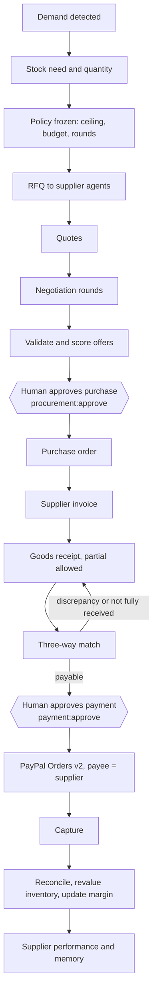

<div align="center">

# Supply Agents

An agent-to-agent procurement network: a buyer agent negotiates with independent supplier agents over a signed
protocol, inside limits a deterministic engine computes first, and a person approves both the purchase and the
payment.

[](README.md)
[](AGENTS.md)
[](PAYPAL.md)
[](SECURITY.md)
[](AUTOMATION.md)

</div>

---

## Contents

- [The lifecycle](#the-lifecycle)
- [Who decides what](#who-decides-what)
- [Inventory intelligence](#inventory-intelligence)
- [The financial engine](#the-financial-engine)
- [Supplier agents](#supplier-agents)
- [The agent protocol](#the-agent-protocol)
- [Negotiation and evaluation](#negotiation-and-evaluation)
- [Approvals](#approvals)
- [Receiving, matching, payment and reconciliation](#receiving-matching-payment-and-reconciliation)
- [Delivery delays](#delivery-delays)
- [Unified intelligence](#unified-intelligence)
- [Permissions](#permissions)
- [API](#api)
- [Screens](#screens)

---

## The lifecycle



Everything above the first approval can run as the [procurement autopilot](AGENTS.md#procurement-autopilot)
LangGraph workflow. Everything after it happens through authenticated endpoints called by a person.

---

## Who decides what

| Decision | Made by | Code |
| --- | --- | --- |
| Whether and how much to buy | Inventory intelligence (deterministic) | [`services/supply/demand.py`](../backend/app/services/supply/demand.py) |
| The merchant's limits | Financial engine (`Decimal`) | [`services/supply/policy.py`](../backend/app/services/supply/policy.py) |
| A supplier's prices | That supplier agent's private policy | [`services/supply/supplier_agent.py`](../backend/app/services/supply/supplier_agent.py) |
| The buyer's counter-offers | Deterministic strategy; an LLM may propose, only in-bounds proposals are accepted | [`services/supply/buyer_agent.py`](../backend/app/services/supply/buyer_agent.py) |
| Which offer wins | Deterministic scoring | [`services/supply/evaluation.py`](../backend/app/services/supply/evaluation.py) |
| Whether to buy, whether to pay | A person with `procurement:approve` or `payment:approve` | [`services/supply/approvals.py`](../backend/app/services/supply/approvals.py) |

---

## Inventory intelligence

For each tracked item, from persisted sales and stock:

* **velocity** = units per day over the last 14 days; demand change against the 14 days before;
* **days of cover** = available / velocity; **stockout risk** when cover <= lead time + 3 days;
* **suggested quantity** = velocity x (lead time + 10-day review + 3 safety days) - available - on order,
  rounded up to the pack size;
* **required within** = whole days of cover remaining.

Seeded demo: Premium Coffee Beans sell **12 a day** (was 7), **42** on hand, 3-day lead time -> **3.5 days** of
cover, suggest **150** bags, needed **within 3 days**.

---

## The financial engine

```
max landed unit cost = selling price x (1 - target margin)    $18.00 x 0.60 = $10.80
max budget           = max landed unit cost x quantity         $10.80 x 150  = $1,620.00
target unit cost     = max landed unit cost x (1 - 12%)        $9.50
landed cost          = unit price x quantity + shipping + tax
```

Every offer, whether from a supplier, from the buyer, or proposed by an LLM, goes through `validate_offer`:

| Verdict | Meaning |
| --- | --- |
| `INVALID` | Non-positive values, a claimed total that does not equal the recomputed landed total, or more than the supplier holds |
| `OUT_OF_POLICY` | Over the unit ceiling or budget, too slow, supplier below minimum reliability, or partial quantity |
| `VALID` | Inside policy; only these can win |

The policy is frozen onto the procurement request with a content-hash version (`pol-...`), and every approval
records the version it was granted under.

---

## Supplier agents

The seeded network has three independent supplier agents, each with a private commercial policy:

| Agent | Strategy | Behaviour |
| --- | --- | --- |
| Summit Roastworks (`supplier.summit`) | Premium and reliable | Opens at list + 3%, concedes 25% of the gap per round, free shipping over $1,500, expedites at no charge |
| Pacific Bean Exchange (`supplier.pacific`) | Low price, limited stock | Lowest list price, only 90 bags, 9-day delivery, concedes 10%, never waives shipping |
| Cascadia Coffee Collective (`supplier.cascadia`) | Flexible negotiator | 4% volume break at 150, concedes 40% (more under competitive pressure), waives shipping to close |

**Isolation is structural.** A supplier engine is built from its own two rows (agent and supply link) and receives
only the public RFQ and the buyer's counters; the types it is constructed from do not contain the merchant's budget,
ceiling or another supplier's terms. The buyer never quotes one supplier's price to another
(`competitive_pressure` is a boolean). `floor_price`, `opening_markup` and `concession_rate` are never serialised
by the API, which a test asserts.

The demo agents are simulated policy engines and are labelled as such. External agents connect through the signed
inbound endpoint below.

---

## The agent protocol

[`services/supply/protocol.py`](../backend/app/services/supply/protocol.py)

**Envelope:** `message_id`, `conversation_id`, `tenant_id`, `sender`, `recipient`, `message_type`,
`schema_version`, `sent_at`, `correlation_id`, `nonce`, `idempotency_key`, `payload`,
`transport {scheme, algorithm, key_id, signature}`.

**One verification boundary.** `MessageBus.deliver` runs for in-process agents and for external agents posting to
`POST /api/v1/agent-messages/inbound`, in this order:

```
tenant -> identity -> signature -> freshness (5 minutes) -> schema (strict, extra fields forbidden)
       -> sender role (a supplier cannot issue a purchase order) -> replay (nonce and idempotency key)
```

* **Signed per agent:** HMAC-SHA256 under a key derived from `AGENT_PROTOCOL_SECRET` and the agent identity, over
  canonical JSON (the same canonicalisation as the n8n outbox). A supplier row copied from another tenant or
  environment fails resolution.
* **Replay protection:** nonce and idempotency key are unique indexes.
* **Vocabulary:** `SUPPLIER_DISCOVERY`, `PROCUREMENT_REQUEST`, `RFQ_CREATED`, `RFQ_RESPONSE`, `QUOTE_SUBMITTED`,
  `COUNTEROFFER`, `OFFER_ACCEPTED`, `OFFER_REJECTED`, `NEGOTIATION_EXPIRED`, `PURCHASE_ORDER_CREATED`,
  `INVOICE_ISSUED`, `DELIVERY_UPDATE`, `GOODS_RECEIVED`, `INVOICE_MATCHED`, `PAYMENT_REQUESTED`,
  `PAYMENT_APPROVED`, `PAYMENT_COMPLETED`, `PAYMENT_FAILED`, `PROCUREMENT_CLOSED`.

The protocol is also published for external integrators as a guide in the APIMatic portal; see
[API portal and SDKs](APIMATIC.md).

---

## Negotiation and evaluation

[`services/supply/negotiation.py`](../backend/app/services/supply/negotiation.py) is a resumable state machine
(`advance`), so the Negotiation Workspace can watch it stage by stage; `run_to_recommendation` loops it to the end.
Each stage is recorded as an agent step, and message idempotency keys derive from the stage, so a re-run reuses
what exists.

Evaluation ([`services/supply/evaluation.py`](../backend/app/services/supply/evaluation.py)) scores only `VALID`
offers. Seeded result, deterministic, no LLM:

| Supplier | Landed total | Score | Outcome |
| --- | --- | --- | --- |
| Cascadia Coffee Collective | $1,455.00 | 0.973 | Recommended |
| Summit Roastworks | $1,570.71 | 0.961 | Valid |
| Pacific Bean Exchange | - | - | Excluded: 9-day delivery, only 90 bags |

The recommendation is **$248.77** below the best opening quote.

---

## Approvals

`approval_requests` stores the canonical terms and their SHA-256. Deciding and executing both rebuild the terms
from live rows; any difference invalidates the approval, durably, on its own transaction. Only people decide: the
agent tools `approve_purchase` and `pay_supplier_invoice` always refuse. Owners are not exempt. Pending approvals
expire after 72 hours. See [Architecture: the approval gate](ARCHITECTURE.md#the-approval-gate).

---

## Receiving, matching, payment and reconciliation

[`services/supply/lifecycle.py`](../backend/app/services/supply/lifecycle.py)

| Step | Behaviour |
| --- | --- |
| **Receiving** | Wraps the inventory receive (stock movement, batch, ledger row), records a goods receipt (partial allowed, on-time flag), then re-runs matching |
| **Three-way match** | Per line: billed vs received vs ordered, price variance against `PROCUREMENT_PRICE_TOLERANCE_PCT`; shipping; total vs payable on goods received (within `PROCUREMENT_TOTAL_TOLERANCE_AMOUNT`). Billing ahead of delivery is `BILLED_NOT_RECEIVED` and holds payment |
| **Payment** | A fully received, payable invoice raises a `SUPPLIER_PAYMENT` approval. Once approved, execution creates a PayPal Orders v2 order with the supplier as payee. Simulated: captured immediately. Sandbox: the payer approves in PayPal, then a person captures. One live execution per invoice |
| **Reconciliation** | PO fully received, match payable, capture settled, paid equals invoiced -> inventory revalued at weighted-average landed cost, product `cost_price` updated, `PRODUCT_MARGIN_CHANGED` emitted, supplier performance recomputed (`0.5 on-time + 0.3 fill rate + 0.2 invoice accuracy`), memory written |

Seeded result: partial receipt of 100 of 150 bags holds payment; the remaining 50 release it; after capture the
inventory is revalued to **$10.12 a bag** and the product margin moves from **35.6% to 43.8%**.

---

## Delivery delays

`POST /purchase-orders/{id}/delivery-delay` plays the supplier's side of the protocol: the supplier agent sends a
signed `DELIVERY_UPDATE` with status `DELAYED` over the same verified bus. Only then does the purchase order's
`expected_at` move; the first committed date is kept as `original_expected_at`. The
[procurement Gantt](INTEGRATIONS.md#bryntum-gantt) redraws the delivery and the PayPal payment that waits on it
in red against the original plan. The delay is recorded in the agent conversation, the run trace and the audit
log (`DELIVERY_DELAYED`).

---

## Unified intelligence

Business events (`business.*`) are written to the transactional outbox with correlation ids:
`REVENUE_ANOMALY_DETECTED`, `PRODUCT_DEMAND_INCREASED`, `STOCKOUT_RISK_DETECTED`, `PROCUREMENT_REQUIRED`,
`RFQ_STARTED`, `SUPPLIER_SELECTED`, `PURCHASE_APPROVED`, `INVOICE_RECEIVED`, `GOODS_RECEIVED`,
`PAYMENT_RECONCILED`, `PRODUCT_MARGIN_CHANGED`, `CAMPAIGN_PERFORMANCE_UPDATED`, `EXPERIMENT_COMPLETED`.

| Signal | Effect |
| --- | --- |
| Demand up and stockout risk | A growth opportunity "Capture rising demand" (value = extra units per day x 30 x price) whose action is to restock through the Supply Agents and hold promotions |
| Stockout risk | Other growth opportunities that would promote the product are down-weighted and annotated "hold until restocked" |
| Cheaper landed cost | Product margin rises in growth analytics |
| Reliability from reconciled orders | Future supplier scoring |

Code: [`services/intelligence/`](../backend/app/services/intelligence/),
[`services/growth/supply_signals.py`](../backend/app/services/growth/supply_signals.py).

---

## Permissions

| Permission | Owner | Admin | Analyst | Staff | Viewer |
| --- | :-: | :-: | :-: | :-: | :-: |
| `procurement:read`, `supplier_invoice:read`, `approval:read`, `paypal:read`, `events:read` | x | x | x | x | x |
| `procurement:create`, `procurement:negotiate`, `paypal:sync` | x | x | x | | |
| `procurement:approve`, `payment:approve`, `payment:execute`, `supplier_invoice:match`, `paypal:manage` | x | x | | | |
| `purchase_order:receive` | x | x | | x | |

The line that matters: an Analyst can source and negotiate but receives `403` on approve and pay.

---

## API

All paths are under `/api/v1`.

| Method | Path | Permission |
| --- | --- | --- |
| GET | `/suppliers`, `/suppliers/{id}` | `vendor:read` |
| GET | `/supply/demand` | `inventory:read` |
| GET | `/supply/overview`, `/supply/timeline` | `procurement:read` |
| GET | `/procurement`, `/procurement/{id}`, `/procurement/{id}/messages` | `procurement:read` |
| POST | `/procurement` (optional `auto_negotiate`) | `procurement:create` |
| POST | `/procurement/autopilot` | `procurement:create` and `procurement:negotiate` |
| POST | `/procurement/{id}/advance`, `/procurement/{id}/negotiate` | `procurement:negotiate` |
| POST | `/procurement/{id}/approve` | `procurement:approve` |
| POST | `/purchase-orders/{id}/goods-receipts` | `purchase_order:receive` |
| POST | `/purchase-orders/{id}/delivery-delay` | `procurement:negotiate` |
| GET | `/goods-receipts`, `/purchase-orders/{id}/lifecycle` | `purchase_order:read` |
| GET | `/supplier-invoices`, `/reconciliations` | `supplier_invoice:read` |
| POST | `/supplier-invoices/{id}/match`, `/purchase-orders/{id}/reconcile` | `supplier_invoice:match` |
| POST | `/supplier-invoices/{id}/approve-payment` | `payment:approve` |
| POST | `/supplier-invoices/{id}/pay`, `/payments/{id}/capture` | `payment:execute` |
| GET | `/approvals`, `/approvals/{id}` | `approval:read` |
| POST | `/approvals/{id}/decide` | `approval:read` plus the approval's own required permission |
| POST | `/approvals/{id}/execute` | `payment:execute` |
| GET | `/agent-messages` | `agents:view` |
| POST | `/agent-messages/inbound` | `procurement:negotiate` and a valid agent signature |
| GET | `/command-center` | `dashboard:read` |
| GET | `/events` | `events:read` |

Full reference: [API reference](API.md).

---

## Screens

| Screen | Route |
| --- | --- |
| Supply overview | `/supply` |
| Reorder and policy | `/supply/reorder` |
| RFQs, quotes | `/supply/rfqs`, `/supply/quotes` |
| Negotiation workspace and agent conversation | `/supply/negotiations`, `/supply/negotiations/{id}` |
| Supplier agents | `/supply/suppliers`, `/supply/suppliers/{id}` |
| Receiving | `/supply/receiving` |
| Supplier invoices | `/supply/invoices` |
| Reconciliation | `/supply/reconciliation` |
| Procurement timeline (Bryntum Gantt) | `/supply/timeline` |
| Approval inbox | `/approvals` |
| Agent-to-agent communication | `/agents/communication` |

---

<div align="center">

[Previous: Agent memory](MEMORY.md) | [Docs index](README.md) | [Next: Supply Intelligence](SUPPLY_INTELLIGENCE.md)

</div>
