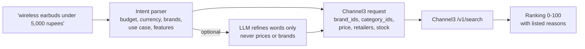
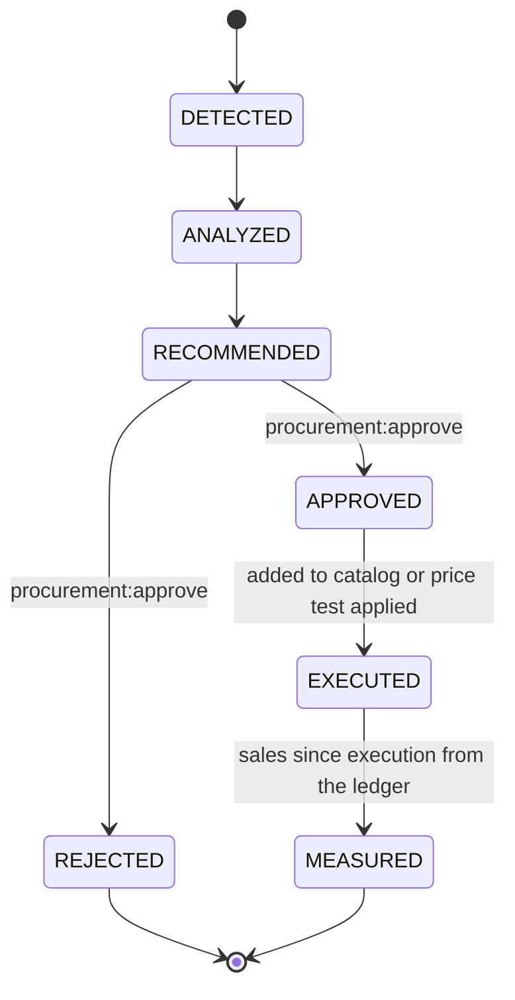

<div align="center">

# Supply Intelligence

Product discovery, assortment analysis and AI recommendations on the live Channel3 catalog, with approved
purchases paid through PayPal.

[](README.md)
[](AGENTS.md)
[](PAYPAL.md)
[](INTEGRATIONS.md)
[](https://docs.trychannel3.com)

</div>

---

## Contents

- [Overview](#overview)
- [Screens](#screens)
- [Channel3 client](#channel3-client)
- [From a sentence to ranked products](#from-a-sentence-to-ranked-products)
- [Comparison](#comparison)
- [Assortment and pricing analysis](#assortment-and-pricing-analysis)
- [Recommendations and their lifecycle](#recommendations-and-their-lifecycle)
- [Approved purchases through PayPal](#approved-purchases-through-paypal)
- [The Merchant OS agents](#the-merchant-os-agents)
- [API](#api)
- [Persistence](#persistence)
- [Configuration](#configuration)
- [Tests](#tests)

---

## Overview

| Layer | Role |
| --- | --- |
| **Channel3** | Live product data: search, details, similar products, URL lookup, conversational shopping |
| **PayPilot agents** | Understand the request, analyse the merchant's own data, rank, compare, recommend, orchestrate |
| **PayPal** | Payment for approved purchases: Orders v2 create, get and capture; verified webhooks |

Nothing in this module is simulated to look real. Without `CHANNEL3_API_KEY` the Channel3-backed routes answer
**`503 CHANNEL3_NOT_CONFIGURED`** with setup steps in `details.setup`; without PayPal credentials, payments run on
the simulator and every row says `SIMULATED`.

---

## Screens

| Screen | Route | Shows |
| --- | --- | --- |
| Supply Intelligence | `/supply/intelligence` | Detected expansion opportunity, KPIs, Growth Autopilot, recommendations, assortment opportunities, category performance, inventory turnover, market price comparisons |
| Product Discovery | `/discovery` | Natural-language search, "what I understood" panel, filters, ranked cards with reasons, similar products, URL enrichment, history, compare tray |
| Product details | `/discovery/products/{id}` | Gallery, offers per retailer, variants, specifications, similar products, shortlist |
| Comparison | `/discovery/compare?ids=a,b,c` | Four evidence-backed verdicts and the side-by-side matrix ("Not listed" where a retailer published nothing) |
| Shopping assistant | `/discovery/assistant` | Multi-turn conversation with Channel3's shopping agent; remembered constraints |
| Alternatives and prices | `/supply/market` | Alternatives to one of your products; your price against live retail listings |
| AI Recommendations | `/recommendations` | Evidence, estimated impact with assumptions, confidence, lifecycle and controls |
| Agent Console | `/agents/console` | Ask the Merchant OS; routing, execution trace, tool calls, activity feed |
| Payment Management | `/finance/payment-management` | Approval workflow, PayPal orders, capture, history |
| Gear shelf | `/shelf` | Live complementary products with affiliate links; see [Integrations: Channel3](INTEGRATIONS.md#channel3) |

---

## Channel3 client

[`integrations/sponsors/channel3_catalog.py`](../backend/app/integrations/sponsors/channel3_catalog.py), verified
against the live API.

| Endpoint | Used for |
| --- | --- |
| `POST /v1/search` | Discovery, assortment expansion, market prices, alternatives by title |
| `POST /v1/similar` | Similar products; a `404` (not yet indexed) falls back to a title search, as documented |
| `GET /v1/products/{id}` | Product details; re-fetched before prices and links are shown |
| `POST /v1/lookup` | URL enrichment |
| `GET /v1/categories/search` | Category hint to `category_ids` filter (filters beat query-stuffing) |
| `GET /v1/brands/search` | Brand name to `brand_ids` (exact name match only) |
| `POST /v1/conversations` (`stream: false`) | The conversational shopping agent, with the budget pinned as a filter |

| Concern | Behaviour |
| --- | --- |
| Authentication | `x-api-key`, server side only. Merchant calls carry an opaque `x-user-id: paypilot-<merchant>` for Channel3 attribution; never a name or email |
| Reliability | Per-request timeout; bounded retries with exponential backoff and `Retry-After` on network errors, timeouts, 429 and 5xx; 4xx never retried; conversation turns never retried (not idempotent) |
| Rate limiting | The API-wide limiter plus 40 Channel3 calls per minute per merchant (shared through Redis when configured) |
| Normalisation | Only what Channel3 returned: ratings only when sent, missing specifications stay missing. Short-lived affiliate offer URLs are never stored |
| Currencies | Channel3 prices in USD, CAD, AUD, GBP, EUR, SEK, CZK, RON. A budget in another currency is converted with the reference rate in `DISCOVERY_FX_PER_USD`, and the response says it is not a live rate |

---

## From a sentence to ranked products



1. **Intent** ([`services/discovery/intent.py`](../backend/app/services/discovery/intent.py)): a deterministic
   parser extracts budget, currency, ranges, brands, exclusions, retailers, use case, features and sale or stock
   preferences. With `GROQ_API_KEY` an LLM may refine the product phrase, category hint and features; it cannot
   change a price, and a brand is accepted only if the merchant typed it.
2. **Request:** brands to `brand_ids`, category hint to `category_ids` (widened once, and labelled, if fewer than
   three results come back), budget to `price`, plus retailer, availability and sale filters.
3. **Ranking** ([`services/discovery/ranking.py`](../backend/app/services/discovery/ranking.py)): a 0-100 score
   from Channel3 relevance, budget fit, availability, requested features, brand preference, retailer coverage,
   ratings (only with at least 10 reviews) and, with an LLM and a stated use case, a use-case fit judged only from
   the returned facts. Components that do not apply are dropped and the weights renormalised. Every card lists its
   reasons.

---

## Comparison

[`services/discovery/comparison.py`](../backend/app/services/discovery/comparison.py) answers four questions with
evidence:

| Verdict | Rule |
| --- | --- |
| Better value | Lowest in-stock price; rating-per-price only if every product has a rating |
| More suitable specifications | Requested features first, then documented attributes |
| Fits your customers | Closest to the merchant's own average order value and catalog price band, from their transactions |
| Best alternative | The closest runner-up: same category, shared specifications, price gap |

---

## Assortment and pricing analysis

| Analysis | Code | Notes |
| --- | --- | --- |
| Assortment | [`services/supply_intel/analysis.py`](../backend/app/services/supply_intel/analysis.py) | SQL only: category and product performance against the previous window, channel and daypart split, basket pairs, inventory turnover and cover, and expansion candidates next to products with real, rising demand |
| Market price | [`services/supply_intel/pricing.py`](../backend/app/services/supply_intel/pricing.py) | Your selling price against comparable live listings, kept only when they cluster in one Channel3 category. Unit cost is shown separately; retail prices never touch a budget or limit |
| Alternatives | [`services/supply_intel/recommendations.py`](../backend/app/services/supply_intel/recommendations.py) | Your product to the closest Channel3 listing to `/v1/similar`, with the difference to your price; any alternative can be saved as a recommendation |

---

## Recommendations and their lifecycle



| Field | Source |
| --- | --- |
| Evidence | SQL over the merchant's sales (buyers, units, growth, online share) and Channel3 (listings, median retail price, retailers) |
| Expected impact | A labelled **estimate**, with its assumptions listed (the attach rate is an assumption, not a measurement) |
| Suggested test quantity | Only with at least 10 buyers; bounded to 6-48 |
| Confidence | Additive from data volume, rising demand, listings found and online share; each reason listed |
| Description | Deterministic; an LLM may reword it from the facts (numbers unchanged), marked "AI-written" |

Generation is idempotent: an open recommendation for the same slot is refreshed in place, and one a person decided
in the last 14 days is not re-proposed. Rejections are written to [agent memory](MEMORY.md) as a signal not to
re-propose without new evidence.

**Execute** moves no money: an assortment or alternative recommendation adds the product to the catalog (`C3-<id>`
SKU, source recorded) so its sales can be measured; a pricing recommendation applies the capped price test.
**Measure** reports units, revenue and orders since execution from the transaction ledger, the PayPal payment
status, and attainment against the estimate. "No sales yet" is reported as such.

---

## Approved purchases through PayPal

```
recommendation APPROVED
  -> POST /supply/recommendations/{id}/purchase  person or PayPal Transaction agent  -> MERCHANT_PURCHASE approval, PENDING
  -> POST /approvals/{id}/decide                 person with payment:approve          -> terms re-hashed from live state
  -> POST /payments/orders                       person with payment:execute          -> PayPal Orders v2 create, idempotent
  -> payer approves at the PayPal approve link   sandbox buyer account
  -> POST /payments/capture                      person with payment:execute          -> order re-read; capture only if APPROVED
  -> PAYMENT.CAPTURE.COMPLETED webhook           signature-verified, replay-guarded   -> same settlement, idempotent
```

* The approval binds (SHA-256) the recommendation, Channel3 product, quantity, the supplier's unit cost (never a
  retail price), total, currency and payee. If the recommendation's product changes, the approval is invalidated.
* One live execution per approval: the idempotency key `merchant-purchase:<approval>:<attempt>` is sent as
  `PayPal-Request-Id`, so a double click returns the same order. A failed create re-opens the approval; no money
  moved.
* Rows reuse `approval_requests` and `financial_executions`, so they appear in the Approvals inbox and the Payments
  ledger with their mode.
* Channel3 never provides checkout: retailer links go to the retailer's site.

---

## The Merchant OS agents

[`agents/merchant_os.py`](../backend/app/agents/merchant_os.py): one LangGraph workflow with an orchestrator and six
specialists (Business Intelligence, Product Discovery, Supply Intelligence, Pricing Intelligence, Growth Strategy,
PayPal Transaction). Each specialist's tools are listed in [Agents: Merchant OS](AGENTS.md#merchant-os).

Every call goes through the shared tool registry: typed arguments, a permission check against the person the agents
act for, merchant scope, structured logs, Langfuse spans and a row in `agent_tool_calls`. The graph ends at the
approval gate; no agent can approve, create an order, capture or pay.

The **Merchant Growth Autopilot** (`POST /growth/autopilot/run`) is the Growth Strategy agent's workflow: analyse
performance, identify opportunities, discover products on Channel3, generate recommendations, estimate impact,
present, request approval. Execution and measurement continue only from a person's action.

---

## API

All under `/api/v1`, merchant-scoped by membership and permission-gated.

| Method | Path | Permission |
| --- | --- | --- |
| GET | `/supply/discovery/status` | `products:read` |
| POST | `/supply/search`, `/supply/compare`, `/supply/similar`, `/supply/enrich` | `products:read` |
| GET | `/supply/products/{id}`; POST `/supply/products/{id}/shortlist` | `products:read` |
| GET | `/supply/searches`, `/supply/discovered`, `/supply/comparisons` | `products:read` |
| POST | `/supply/assistant`; GET `/supply/assistant/conversations[/{id}]` | `products:read` |
| GET | `/supply/intelligence`, `/supply/assortment`, `/supply/catalog-products` | `products:read` |
| POST | `/supply/pricing`, `/supply/alternatives` | `products:read` |
| POST | `/supply/alternatives/save` | `growth:recommend` |
| GET | `/supply/recommendations`, `/supply/recommendations/{id}` | `growth:read` |
| POST | `/supply/recommendations/generate`, `/supply/recommendations/{id}/measure` | `growth:recommend` |
| POST | `/supply/recommendations/{id}/approve`, `/reject`, `/execute` | `procurement:approve` |
| POST | `/supply/recommendations/{id}/purchase` | `procurement:create` (creates an approval request) |
| POST | `/growth/autopilot/run` | `growth:recommend` and `agents:run` |
| GET | `/growth/autopilot` | `growth:read` |
| POST | `/agents/execute` | `agents:run` |
| GET | `/agents/activity`, `/agents/catalogue` | `agents:view` |
| POST | `/payments/orders`, `/payments/capture` | `payment:execute` |
| GET | `/payments/orders/{id}`, `/payments/history` | `paypal:read` |
| POST | `/payments/webhooks/paypal` | none; signature-verified (alias of `/paypal/webhooks`) |

---

## Persistence

Migration `0007_supply_intelligence` is additive: `product_searches`, `discovered_products`,
`product_comparisons`, `merchant_recommendations`, `shopping_conversations`. Agent runs, approvals and payments
reuse `agent_runs`, `agent_steps`, `agent_tool_calls`, `approval_requests` and `financial_executions`.

---

## Configuration

| Variable | Default | Purpose |
| --- | --- | --- |
| `CHANNEL3_API_KEY` | blank | Enables everything above (free key at trychannel3.com/developers) |
| `CHANNEL3_BASE_URL` | `https://api.trychannel3.com` | |
| `CHANNEL3_TIMEOUT_SECONDS`, `CHANNEL3_MAX_RETRIES` | `30`, `2` | |
| `CHANNEL3_CURRENCY`, `CHANNEL3_COUNTRY` | `USD`, `US` | Locale offers are priced in |
| `DISCOVERY_FX_PER_USD` | `INR:88,JPY:150,...` | Labelled reference rates for budgets in other currencies |
| `DISCOVERY_DETAIL_CACHE_SECONDS` | `600` | Product-detail reuse window |
| `GROQ_API_KEY` | blank | Optional: routing, wording, use-case fit |

PayPal settings are in [Configuration: PayPal](CONFIGURATION.md#paypal). `make integrations` verifies the Channel3
key and the PayPal sandbox credentials with one lightweight call each, without printing a secret.

---

## Tests

[`tests/unit/test_channel3_catalog.py`](../backend/tests/unit/test_channel3_catalog.py),
[`tests/unit/test_discovery_engine.py`](../backend/tests/unit/test_discovery_engine.py) and
[`tests/integration/test_supply_intelligence.py`](../backend/tests/integration/test_supply_intelligence.py).
Channel3 is mocked at the HTTP transport (the real client, request builder and parser run) and PayPal is the
simulator. They cover normalisation, filters, retries, no-key behaviour, intent parsing, currency conversion,
ranking, comparison, conversation memory, routing, RBAC, tenant isolation, the full recommendation -> approval ->
PayPal order -> capture -> webhook path, approval invalidation on changed terms, generation and deduplication, and
that the PayPal agent can request but never pay.

---

<div align="center">

[Previous: Supply Agents](SUPPLY_AGENTS.md) | [Docs index](README.md) | [Next: PayPal integration](PAYPAL.md)

</div>
